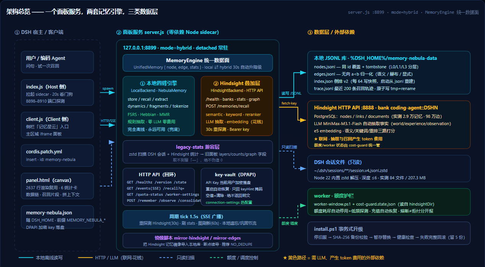
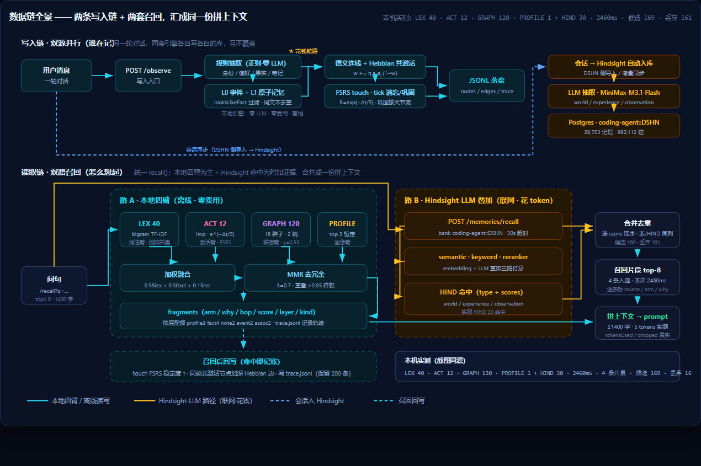
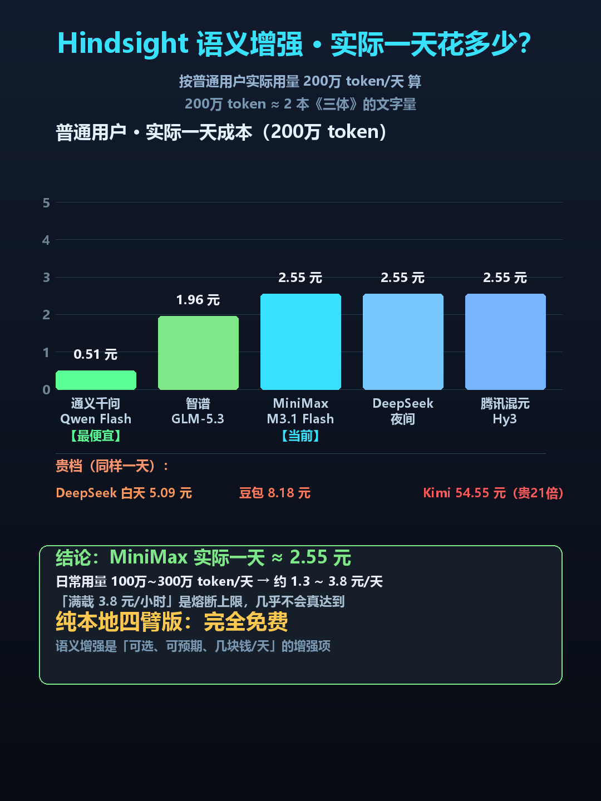

# Nebula Memory

> **零依赖 · 纯本地 · 可视化的 Agent 记忆系统。装完即用，不花钱，不上云。**

一个自包含的记忆引擎：**本地 JSONL 四臂召回**（词法 / 激活 / 图扩散 / 画像）+ **可交互的记忆星云可视化面板**，可选叠加 **Hindsight HTTP API** 做语义增强。核心引擎永远可独立运行——**不联网、不烧钱、不依赖任何数据库或 LLM**。

[](#license)
[](#)

> **🚀 小白想直接用？看 [快速上手（保姆级教程）](docs/快速上手.md)** —— 不写代码，跟着做就能用上。
>
> **🖥 你在用 DeepSeek Harness（DSH）？直接把本仓库地址发给 DSH，让它帮你装**（见 [安装到 DSH](#安装到-dsh)）。


*记忆星云面板实时动画：星云粒子呼吸 · 召回卡片轮换点亮 · 四臂命中 · 数据链实时刷新*

---

**Performance (Real-world Benchmark)**

· Recall (p50): ~13ms (23.8k nodes / 41.4k edges, auto-compacted)  
· MCP E2E (p50): ~31ms  
· Cold Start: ~2.0s (auto-compacted bank)  
· Zero external dependencies / 100% offline

> 📊 以上为本机真实运行库快照的实测值，可一键复现：`node scripts/bench.mjs` · 完整报告见 [性能实测报告](docs/性能实测报告.md)

**Recall Quality (100 Q&A Benchmark)** —— 召回准不准

| 方案 | Recall@20 | 说明 |
|---|---|---|
| **RRF 融合**（本地 + Hindsight） | **93.0%** | 同口径最优，比纯本地高 6 个百分点 |
| 纯本地 | 87.0% | 零依赖、离线、毫秒级 |

· 查询扩展（拼音纠错 + 同义词 + 画像反哺）另测 50 题：64.0% → 88.0%，其中错别字档 50.0% → 87.5%（8 题，±12.5pp）
  —— 内置词典覆盖通用错词与常见概念组；行业术语需用 `setUserSynonyms()` 自行追加，效果随词典覆盖度变化
· 上表题库：100 题 / 20 条事实库，按语义距离分 near(24) / mid(35) / far(41) 三档

> 📊 可复现：`node scripts/bench-4groups.mjs`、`node scripts/cross-paraphrase-50.mjs`
> 完整报告见 [召回效果实测报告](docs/召回效果实测报告.md)，**引用前请先读该报告 §7「对外引用须知」**——
> 其中标注了哪些数字可对外引用、哪些仅限内部同口径比较。

**Capacity (Scale Limit)** —— 诚实说明能扛多大

| 记忆量 | 召回 p50 | 建议 |
|---|---|---|
| **< 5 万条** | < 50 ms | ✅ 最佳区间，纯本地无感知 |
| **5 万 ~ 10 万** | 100~350 ms | ⚠️ 可用；建议按项目切 `namespace` 分库 |
| **10 万 ~ 50 万** | 1.7~2.8 s | ⚠️ **此时应启用双引擎**：本地留近期/*热点*，全量交给 **Hindsight** |
| **> 50 万** | — | 双引擎必需，本地只做缓存层 |

> 实测 10 万条 319ms / 50 万条 1.75s，冷启动与内存均线性可控（内存 7.4 KB/节点）。
> 瓶颈在候选集打分，不在索引查找。详见 [规模上限实测报告](docs/规模上限实测报告.md)。

**这不是缺陷，是设计边界。** 本项目方案由两部分组成：**本地引擎（适合单机个人用户——记忆量在 10 万条以内、追求零依赖离线运行、不想为每次对话付费）** + **Hindsight 语义增强（适合需要跨表述语义联想、历史库超过 10 万条、或多人共享同一记忆库的团队场景，可按需接入）**：

- **本地引擎（零依赖）**负责存储侧：切块入库、图扩散控度、内存驻留、自动压实、离线兜底；
- **Hindsight** 负责语义侧：跨表述联想、全量历史检索、向量召回。

两者经 MCP/HTTP 并存，插件并发请求两侧并 RRF 融合（Hindsight 受 3s 超时保护，
慢或不可用时静默降级纯本地）。所以「超过 10 万条」不是要放弃本地，而是**让它退到缓存层**——
本地永远保证「最近的记得住、查得到」，Hindsight 保证「久远的也能语义找回」。

---

## 为什么是它

> **Works 100% offline. Zero dependencies. No API keys required.**
> 100% 离线运行 · 零依赖 · 无需任何 API Key。

市面上的 Agent 记忆框架（[Mem0](https://github.com/mem0ai/mem0)、[Zep](https://github.com/getzep/zep)、腾讯 [TencentDB Agent Memory](https://github.com/Tencent/TencentDB-Agent-Memory) 等）普遍**很重**——要 Postgres / MongoDB / 向量库、要云端 LLM、要部署脚本、每次对话都在烧钱、数据要上云。

**Nebula Memory 走相反的路线**：

| | 重型框架（Mem0/Zep/腾讯） | Nebula Memory |
|---|---|---|
| 依赖 | 数据库 + 向量库 + LLM | **零依赖（纯 Node.js）** |
| 部署 | 多步、要配置 | **一条命令 / 一个 import** |
| 成本 | 每次对话烧钱 | **零成本（纯本地）** |
| 隐私 | 数据上云 | **数据不出本机** |
| 体积 | 几十 MB 起步 | **~160 KB** |
| 可视化 | 通常没有 | **记忆星云面板（3D 星图 + 召回轨迹）** |

一句话：**重型框架是「企业记忆中台」，Nebula Memory 是「个人开发者的零依赖记忆」**。

### 关于「断网可用」的准确含义

经常有人问："AI 模型不是要联网调 API 吗，断网怎么用？" 这里要分清链路里的**两个独立部分**：

```
你的问题
  ├─ ① 记忆系统（本项目）：从本地库找出相关记忆、拼成上下文   ← 断网可用 ✅
  └─ ② AI 大模型：把上下文写成通顺回答                      ← 云 API 需联网 ❌ / 本地模型可用 ✅
```

- **本项目的部分（①）确实断网可用**：记忆存本地 JSONL，检索靠词频 + 倒排索引 + 图扩散，**全程不联网、不调模型、不烧 token**。断网时依然能召回相关记忆、拼好上下文。
- **AI 生成回答（②）** 是模型本身的事：用 Claude / ChatGPT 等云 API 时需要联网；想「完全离线」，给这一步配个本地模型（Ollama / llama.cpp 等）即可——本项目对外只返回上下文文本，谁来生成回答都行。

> 所以「断网可用」指的是**记忆的存取与召回**，不是指 AI 模型能断网思考。

### 坦诚对比：你该选哪个？

- 想要**开箱即用的云原生托管记忆** → 用 [TencentDB Agent Memory](https://github.com/Tencent/TencentDB-Agent-Memory) 或 [Mem0](https://github.com/mem0ai/mem0)；
- 想要**方便接入 Python 生态** → 用 LangChain Memory；
- 想要一个**完全属于自己、不花一分钱 Token、断网也能用、甚至能在树莓派上跑起来**的极客级记忆引擎 → **用 Nebula Memory**。

> **本地四臂模式已足够满足日常记忆需求**，Hindsight 语义增强是进阶可选（见 [关于语义增强](#关于语义增强hindsight)）。

---

## 特性

- 🔌 **零依赖**：纯 Node.js + JSONL 文件，没有 npm 依赖、没有数据库、没有向量库
- 🏠 **本地优先**：记忆存在你自己的机器上，不联网、不上云、不泄露
- 🧠 **四臂召回**：词法（TF-IDF）· 激活（FSRS 遗忘曲线）· 图扩散（2 跳）· 画像，本地就能做语义相关的记忆检索
- 🎨 **可视化面板**：记忆星云 3D 星图、数据链、召回轨迹、SSE 实时刷新
- ⚡ **快**：冷启动 ~2.0s；**纯本地召回实测 p50 ≈ 13ms、p90 50ms**（2.4 万节点真实库 + 自动压缩，纯内存计算，详见[性能实测报告](docs/性能实测报告.md)）
- 🧩 **可叠加增强**：可选接 Hindsight HTTP API 做 LLM 语义检索（不装也完全能用）
- 📌 **置顶永固**：`importance=1.0` 的关键事实（API 密钥、称呼偏好）永不受时间衰减

### 关于实现语言：为什么选纯 Node.js

选型的第一原则是**适配**。这个项目以 DSH 插件形态运行：`index.js` 通过宿主提供的
插件接口挂载，`client.js` 向前端注入面板入口，面板服务本身也由同一个运行时托管。
三者都要长在宿主的 Node 环境里——用 Node 写可以直连，不必额外架一层进程间通信，
也不必为记忆工具再维护一套 Python 环境。

其次是部署上的两点便利：

- **无第三方运行时依赖**：`package.json` 的 `dependencies` 为空，代码只用到
  `node:fs` / `node:path` / `node:http` / `node:crypto` / `node:zlib` / `node:os` /
  `node:url` / `node:module` 这几个内置模块。
- **分发形态简单**：`npx nebula-memory-mcp` 一条命令即可运行，不需要 `pip install`、
  不需要 venv、不需要额外安装数据库服务。MCP 客户端（Claude Desktop / Cursor 等）
  会反复拉起工具进程，启动环节越少，出问题的概率越低。

> 补充说明：我们做 SQLite 可行性测试时，**刻意用 Python 逐行复刻了 Node 的
> `init()` 作为对照基线**，目的是让差异只归因于存储架构，不混入语言运行时差异。
> 因此**那批数据不能用来比较 Node 与 Python**——我们没有做过这个对比，
> 选型依据也不是语言之间的快慢，而是上面的适配与部署条件。
>
> 那次测试的结论是存储层**暂不切换、保持纯 JSONL**，本地留档不发（脚本在独立目录维护）。

---

## Quick Start（5 行跑通）

```bash
git clone https://github.com/yb-zhai/agent-memory.git
```

```javascript
import { NebulaMemory } from './agent-memory/memory/index.mjs'

const memory = new NebulaMemory({ dir: './my-memory' })
await memory.remember('老板喜欢喝冰美式')
await memory.remember('生产环境部署偏好：Docker Compose 而不是 K8s', { importance: 1.0 })  // 置顶，永不遗忘（⚠️ 别存真实密钥/密码，见 SECURITY.md）
const context = await memory.recall('老板喝什么？')   // → 命中「冰美式」
```

> 完全不需要配置 Postgres、不需要 API Key、不需要联网。跑完上面这段，你的 Agent 就有了记忆。
>
> **引擎与模型无关**：`NebulaMemory` 是纯 Node.js 模块，任何 Agent（Claude / GPT / 文心 / 通义 / 自研模型）都能用——把它召回的记忆塞进 prompt 即可。

### 想用语义增强？

本地四臂已经能解决大部分记忆召回。如果你想要更强的语义检索，可以叠加 **Hindsight HTTP API**（可选），见 [Hindsight 叠加](#hindsight-叠加可选)。

### 自定义词表（行业术语 / 专属错别字）

内置词典只覆盖**通用**高频错词与常见概念组（`布署→部署`、`秘钥→密钥`、`供应商↔厂家`）。
行业术语（医疗「骨膜」、工控「PLC」、自家产品代号）无法穷举，交给用户自己补：

在数据目录放一个 `user-dict.json`，启动时自动加载：

```json
{
  "typoMap": {
    "骨模": "骨膜",
    "神精": "神经"
  }
}
```

- 只加 `typoMap`（错别字纠正）；同义词扩展另见 `setUserSynonyms()`
- 自反条目（`"X": "X"`）会被**自动忽略并告警**——它们不产生任何效果
- 文件不存在时静默跳过，零配置照常工作
- 用户词表**优先于**内置词表（同名键覆盖）

> ⚠️ 纠错是**无上下文的全量替换**，没有语境判断能力。词表加得越多、误伤正确词的风险越大，
> 只把真正高频的错法放进去。效果随词典覆盖度变化——内置那部分是通用收益，行业那部分要自己补。

---

## 截图

<!-- TODO: 放一张记忆星云面板的截图或 GIF，这是最打动人的部分 -->
<!-- 建议录制：输入一句话 → 面板上节点瞬间点亮 → 召回卡片出现 -->

---

## 安装 / 接入方式

Nebula Memory 有三种用法，按需选择：

### 1. 作为库（Node.js，任何模型可用）

```bash
git clone https://github.com/yb-zhai/agent-memory.git
```

```javascript
import { NebulaMemory } from './agent-memory/memory/index.mjs'
const memory = new NebulaMemory({ dir: './memory' })
await memory.init()
await memory.remember('...')
await memory.recall('...')
```

> 引擎是纯 Node.js、零依赖、与模型无关——把它召回的记忆塞进任意模型的 prompt 即可。

### 2. 作为独立 HTTP 服务

```bash
node server.js
```

启动后监听 `127.0.0.1:8898`，暴露 REST API（`/recall`、`/remember`、`/state`、`/graph` 等）和 SSE 实时推流。任何语言（Python / JS / 其他）都能用 `requests` / `fetch` 调用。

### 3. 作为 MCP Server（接入 Claude / Cursor / ChatGPT / Grok / Gemini 等）

**最省事：用 npm 包，一条 `npx` 命令，不用 clone 仓库、不用装依赖：**

```json
{
  "mcpServers": {
    "nebula-memory": {
      "command": "npx",
      "args": ["-y", "nebula-memory-mcp@latest"],
      "env": { "NEBULA_DATA_DIR": "/path/to/your/memory" }
    }
  }
}
```

包地址：[nebula-memory-mcp on npm](https://www.npmjs.com/package/nebula-memory-mcp) · 零依赖 · 49KB。

写一个 MCP Server，就同时接入了 **Claude、Cursor、ChatGPT、Grok、Gemini、Windsurf、Cline** 等所有支持 MCP 的主流 AI 客户端——它们都能直接读写你的记忆。**当前为纯本地版**（零依赖、零花费），Hindsight 语义增强版后续跟进。详见 [docs/MCP.md](docs/MCP.md) 或 [小白版快速上手](docs/快速上手.md)。

> 想用源码方式（而非 npm 包）：`command` 填 `node`，`args` 填 `["路径/mcp-server.mjs"]` 即可。

**装完怎么用？** MCP 是后台工具，AI 不会自动用——直接说「**记住：xxx**」存记忆，说「**我之前说过 xxx 吗？**」取记忆。如果 AI 说没这工具，提醒它一句「你有 nebula-memory 的 MCP 工具，用 remember/recall」即可。详见 [快速上手第 6 步](docs/快速上手.md)。

### 多 Agent 共享记忆

一套记忆，**所有 Agent 共享**——这是 MCP 架构最自然的用法。

```
NebulaMemory（一个库）
  └─ MCP Server（一个进程）
       ├─ Claude Desktop   记忆互通
       ├─ Cursor           记忆互通
       ├─ ChatGPT          记忆互通
       └─ Windsurf / Cline 记忆互通
```

**做法**：让多个 AI 客户端接入**同一个 MCP Server、指向同一个 `NEBULA_DATA_DIR`**——Claude 记住的东西，Cursor 下次就能查到。零改造、即配即用。

```json
{
  "mcpServers": {
    "nebula-memory": {
      "command": "npx",
      "args": ["-y", "nebula-memory-mcp@latest"],
      "env": { "NEBULA_DATA_DIR": "/path/共享的记忆目录" }
    }
  }
}
```

> 每个客户端的 MCP 配置里填**相同的 `NEBULA_DATA_DIR`**，就是共享同一份记忆。

**几点说明**：

| 场景 | 支持吗 |
|---|---|
| 多个 AI 客户端经 MCP 共享一个库 | ✅ 推荐，最稳 |
| 多个独立进程同时读写一个库 | ⚠️ 追加是原子的、能用，但各进程把库加载进内存，**看不到彼此的实时更新**（需重启同步）；同时跑压缩会冲突，不建议重度并发 |
| 各 Agent 独立库 | ✅ 用工具的可选 `namespace` 参数（`remember`/`recall`/`stats`/`forget` 都支持），不填走默认库、填了走独立子库 |
| 多个独立库之间互相查询 | ❌ 暂不支持（需分别用不同 namespace 调用） |

### 4. 作为 DSH 插件（可视化面板）

如果你用 [DeepSeek Harness](https://github.com/deepseek-ai/DeepSeek)（DSH），可以把它作为插件安装，获得完整的「记忆星云」可视化面板。见 [安装到 DSH](#安装到-dsh)。

---

## API 一览

| 方法 | 作用 |
|---|---|
| `memory.remember(input)` | 写入一条记忆 |
| `memory.recall(query)` | 四臂召回 |
| `memory.observe(input)` | 观察一条（记录但不主动召回） |
| `memory.forget(id)` | 删除一条 |
| `memory.stats()` | 统计（节点/边数量） |
| `memory.consolidate()` | 巩固（相似片段合并、衰减） |

---

## 架构

```
┌──────────────────────────────────────────┐
│            Nebula Memory 引擎              │
│  （零依赖 JSONL · 四臂召回 · FSRS 动力学） │
├──────────────────────────────────────────┤
│  ├─ 本地四臂：词法 / 激活 / 图扩散 / 画像  │
│  └─ 可选叠加：Hindsight HTTP API（语义）   │
└──────────────────────────────────────────┘
```

核心引擎**永远可独立运行**；Hindsight 只是「可选的增强」，不是「必需的前置」。探测不到 Hindsight 就自动降级纯本地，不报错、不伪造数据。

### 架构总览 —— 一个面板服务，两套记忆引擎，三类数据层



### 数据链全景 —— 两条写入链 + 两套召回，汇成同一份拼上下文



> 两图为可交互 SVG 源文件渲染，源码见 [docs/architecture-source.html](docs/architecture-source.html)（含全部数字出处，与代码逐项核对过）。

---

## 常见问题（FAQ）

### Q：用「字典式精确索引」就够了，为什么要四臂召回？

字典式（key → value 精确查找）其实就是四臂里的 **LEX 臂**——倒排索引精确匹配，**记得 key 时它最快最省，已经内置**。

多出来的三臂（激活 / 图扩散 / 画像）不是替代字典，而是覆盖「**记不住 key**」的情况：

- 字典式：记得「11 月 20 号那个报错」→ 秒查；
- 模糊召回：只记得「上次那个容器报错怎么解决的」，不记得哪天、什么词 → 字典没 key 可查，靠图扩散/激活找到。

**如果你的记忆都是按日期精确归档、你也记得住 key，字典确实够用**。四臂是为「AI 要自己想起它忘了的东西」准备的。

### Q：这个和 Obsidian 这类笔记/知识库有什么区别？能被 AI 调用吗？

定位不同，**不是竞品**：

- **Obsidian = 给人用的知识库**：你手动记笔记、双链整理，方便**你自己**搜索、阅读、梳理思路；
- **Nebula Memory = 给 AI 用的记忆层**：AI 通过 MCP 工具自动记（`remember`）、自动召回（`recall`），让它在跨会话时「记得你」，毫秒级响应、零依赖、不用先建笔记库。

关键在于「human retrieval vs agent retrieval」：笔记库是为你搜、你读、你综合设计的；记忆层是为 AI 自动判断什么相关、自动注入上下文设计的。「我写下来了」和「我的 AI 知道了」是两件事。

**能被 AI 调用吗？能，但出发点不同**。Obsidian 也能接进 AI——装个 MCP server（如 `obsidian-api-mcp-server` + 官方 Local REST API 插件）就能让 AI 读写你的 Vault。但那是「把人类笔记库接给 AI」（要装 Obsidian、配插件、笔记是给人看的格式）；Nebula Memory 是「天生为 AI 读写设计」。两者可互补：Obsidian 沉淀你的系统知识，Nebula Memory 存 AI 的工作记忆；需要时把 Obsidian 的重点笔记 `remember` 进记忆层做快速召回。

### Q：「上次那个铸件的客户」能找到「某铸造厂」吗？（bigram 的天花板）

诚实说：**纯本地版直接找不**到——这是零依赖路线的已知边界，不藏着。

- 本地 LEX 臂是中文 bigram 词面匹配：召回「词面有重叠」的记忆很稳（专有名词、代码、报错信息、型号这类场景）；
- 但「铸件的客户 → 某铸造厂」这种**跨表述联想**需要语义向量，本地引擎刻意不做——做了就要带 embedding 模型或数据库，违背零依赖定位；
- 两条补偿路径：① **GRAPH 臂**——如果两条记忆曾在同一次召回里共现（赫布边）或共享标签，两跳扩散能间接搭上；② 可选的 **Hindsight 语义增强层**，这才是为跨表述语义设计的（要 Postgres + LLM，见上文对比表）。

一句话：**词面精确 → 本地足够；跨表述联想 → 图臂间接补偿，或上 Hindsight 增强。**

### Q：最终表现和腾讯那种带 70M 向量模型的 memory 有区别吗？

最终表现都是「AI 记起来」，差别在**代价和边界**：

| | 重型方案（腾讯/Mem0 等） | Nebula Memory |
|---|---|---|
| 依赖 | 70M 向量模型 + 生态 / 数据库 | 零依赖、160KB |
| 成本 | 要资源、可能烧 token | 纯本地零成本 |
| 隐私 | 数据可能上云 | 数据不出本机 |
| 离线 | 依赖模型/服务 | **断网照样跑** |

能做到一样的表现、却不用那套重资产，正是它存在的意义。

### Q：记忆库存的是原文还是向量？

- **本地四臂（默认、开源的部分）**：存**原文**（JSONL 的 `text`），检索靠**词频/倒排索引（TF-IDF，稀疏向量）+ 图结构**。代码里虽有个 `vec` 字段，但那只是给外部透传预留的，**召回算法完全不用它**——没有 embedding 模型、不烧 token、零依赖。
- **Hindsight 语义增强（可选、暂未开源）**：那一层才用真·AI 向量做语义检索，但要 Postgres + LLM，有成本。

### Q：AI 模型不是要联网吗？「断网可用」是什么意思？

见 [关于「断网可用」的准确含义](#关于断网可用的准确含义)。简短说：**记忆的存取与召回断网可用**（本地文件 + 词频检索，不联网不烧 token）；**AI 生成回答**用云 API 需联网，想全离线配个本地模型（Ollama 等）即可。

### Q：接了 MCP 之后，token 开销怎么算？

诚实说清楚，不夸大「零成本」：

- **本地召回本身零 token**：词频 + 倒排 + 图扩散，纯本地计算，不联网、不调模型；
- **MCP 工具有固定开销**：作为 MCP 工具接入后，工具说明书（schema）会常驻模型上下文，约 **1~2k token/轮**——这是**所有 MCP 工具的通用现象**，不是本项目特有；
- **召回内容占少量 token**：找回的记忆会拼进 prompt，换来的是「不用每轮重读整段历史」。

一句话：**用一点 token 换「AI 记得你」**，不是零成本，但省的是「整段历史反复塞」的大头。如果这笔固定开销不划算，可以把 MCP 连接器改成**按需启用**而非始终注入。

### Q：能让几个 Agent 共享记忆吗？

见 [多 Agent 共享记忆](#多-agent-共享记忆)。简短说：多个 AI 客户端接入同一个 MCP Server、指向同一个 `NEBULA_DATA_DIR`，就共享同一份记忆。

### Q：这不就是早期的 memory.json 本地化吗？

不是。早期 JSON 本地化是**文本倾倒**：把整段对话存进去，召回时全量塞进 prompt（或套个裸向量库查一下）。

Nebula Memory 把 JSONL 只当**持久化介质**，在上面跑了一个**零依赖的内存级记忆搜索引擎**：

- **四臂召回**：词法（LEX）+ FSRS 时间衰减（ACT）+ 图扩散（GRAPH，4 万余条边、2 跳）+ 画像（PROFILE）；
- **RRF 融合**：本地规则分与外部语义分统一排序，避免大模型分数淹没本地精准命中；
- **冷启动重建**：2.9s 内加载数万节点与边，在内存重建倒排索引和邻接图；
- **毫秒级召回**：2.4 万节点真实库实测 p50 ≈ 25~28ms（[性能实测报告](docs/性能实测报告.md)）。

打个比方：早期 JSON 本地化是「把书堆进仓库」，Nebula Memory 是「在仓库里建了一个自带编目、检索、遗忘机制的数字图书馆」。

> 如果你只要极简文本转储，简单 json 文件够用；如果你要**图谱联想、时间衰减、离线可解释的召回**，才需要这套。

### Q：本地 JSONL 是不是意味着只能本地用、不能上云？

不是。本地 JSONL 是**唯一事实来源**（Single Source of Truth），目的是数据主权、零延迟、断网可用。但这不等于「只能本地」——可选的 **Hindsight 增强层**对接的是 HTTP API，可以本地也可以远程部署，与本地引擎是解耦的。

设计原则是「**没有网也能用**」，不是「不能用网」。

### Q：能不能每天跑 RAG-LLM-Wiki，做无限存储和向量化？

这个愿景很宏大，但不放进核心引擎，原因有三：

1. **原始记忆要保真**：LEX 臂与原文存储就是为了精准还原「那天到底改了哪行代码、报了什么错」。LLM 把对话压成 Wiki 会丢细节（具体参数、报错堆栈），等于把「档案室」改成「百科全书」；
2. **成本与初衷冲突**：每日长上下文总结极耗 token，与「零 token 保底、毫秒级本地召回」的路线相悖；Hindsight 增强层已在做 LLM 抽取和向量化，再加一层 Wiki 冗余；
3. **架构边界**：双结构引擎的初衷就是把「不可变原始记忆（本地）」和「可演进语义认知（外脑/插件）」解耦。

**想要 Wiki？做成外部插件**：通过 REST/SSE API 拉取 trace/nodes，交给 LLM 生成词条，存到你喜欢的向量库。核心保持极简，无限记忆交给上层组合。

### Q：没有感官输入、靠文本喂饭，算得上「自主 AI」吗？

这是**感知与记忆的分工**问题。眼耳（多模态输入）是模型厂商的方向；我们做的是 AI 的「海马体」——负责存储、压缩、遗忘、关联。模型未来就算有极强的眼耳，依然需要一个记忆底座来刻录这些信息。

而且恰恰相反：没有长期记忆的 AI 才是每次无状态重设；能记住你三个月前的偏好、并在今天精准结合，才是「连续性」的起点。

> 我们不做「假装有自主意识」的噱头，就是一个工程扎实的记忆引擎——把记忆刻在本地，开源给大家自由控制。

---

## 关于「语义增强（Hindsight）」

> **这一节专门说清楚：为什么你现在用不到它，以及以后会怎样。**

### 一句话解释

Nebula Memory 有两档能力：

| 档位 | 是什么 | 现在能用到吗 |
|---|---|---|
| **本地四臂（默认）** | 词法 + 激活 + 图扩散 + 画像，纯本地、零依赖、零成本 | ✅ **开箱即用**，这就是你装完就能用的东西 |
| **语义增强（Hindsight）** | 额外的 LLM 语义检索，召回更"懂意思" | ❌ **暂未提供**，原因见下 |

### 为什么「语义增强」现在没开源？

它不是一个"文件"或"一行配置"，而是一整套**独立的重型系统**：

- 需要一个 **Postgres 数据库**；
- 需要一个 **LLM**（要花钱调 API）；
- 还需要 **worker 后台调度 + 额度熔断** 等一整套运维；
- 整套体积很大（模型文件就几个 GB）。

**把它塞进安装包，会破坏这个项目最核心的优点——「零依赖、装完即用、不花钱」。**

所以现在的策略是：**先只开放「本地四臂」这一档**，它已经能解决大部分 Agent 记忆需求，而且是零依赖、零成本的。

### 以后会怎样？（Roadmap）

插件**已经预留了接口**（`HINDSIGHT_URL` 环境变量）——如果你自己恰好有一套兼容的 Hindsight 服务，填上地址就能自动叠加（每 30 秒探测一次，`local` ↔ `hybrid` 自动切换）。

**标准安装暂不含 Hindsight**。等我们把「语义增强」做成更轻、更容易装的形式（比如轻量 embedding，或云端服务），再提供给大家。

### 成本透明：语义增强到底花多少钱？

很多人关心「语义增强」会不会很贵。我们按真实负载把账算清楚、公开出来：



几个关键数字：

- **满载一小时**（3M token，≈ 3 本《三体》的文字量）≈ **3.8 元**（MiniMax M3.1 Flash，平价无夜间折扣）；
- **这是熔断上限，几乎不会真达到**——普通用户实际一天约 100万~300万 token，折合 **1.3 ~ 3.8 元/天**；
- **纯本地四臂版永远免费**，语义增强是「可选、可预期、成本透明」的增强项。

> 所以放心：就算以后接上语义增强，成本也是**明码标价、几块钱/天的量级**，不会是无底洞。

> **放心用本地四臂就行**：它零依赖、零成本、装完即用，是这个项目当前最可靠、最值得用的部分。

---

## 版本说明（三条独立版本线，别混淆）

本项目对外有三条版本线，**各自独立是设计如此**，不要以为它们应该相等：

| 版本线 | 当前 | 代表什么 | 谁在读 |
|---|---|---|---|
| **DSH 插件** `dsh-memory-nebula` | 1.3.12 | 完整产品：面板 + 本地引擎 + 可选 Hindsight，装进 DSH 用 | DSH 插件管理器、`install.ps1` |
| **npm 包** `nebula-memory-mcp` | 1.2.1 | 纯 stdio MCP 工具（只有 `mcp-server.mjs`），给 Claude / Cursor 等接入 | npm / npx 用户 |
| **MCP Registry 条目** | 1.5.x | Registry 上的发布版本，指向某一版 npm 包 | MCP 客户端 |

**为什么不同**：三个包的内容与用途根本不同——DSH 插件带面板和 HTTP 服务，npm 包只有一个 MCP 入口文件，Registry 条目是发布记录。强行统一版本号只会让"同名不同物"更混乱。

**真正必须一致的是同一包内部**：例如 DSH 插件的 `package.json` 版本与 `server.js` 的 `VERSION` 必须相等，否则 `install.ps1` 的健康检查会判定升级失败并回滚。这是安装机制的要求，与上面三条版本线无关。

## 升级与数据自查

### 1.3.12 变更

**1. 升级前校验包内版本号自洽**

`install.ps1` 在动任何文件之前，先比对包内 `package.json` 的 `version` 与
`server.js` 的 `VERSION`。两者不等则直接报错退出，不进入安装流程。

这不是防用户，是防发布方自己：1.3.9 和 1.3.10 两次发版漏改 `server.js` 的
`VERSION`，导致健康检查判定失败、所有升级被静默回滚，缺陷也因此被遮盖了一天多。
现在这类问题在动手之前就会被拦住，并给出明确原因。

**2. 启动时清理残留的临时文件**

写 `index.json` 用的是「写临时文件 → rename 覆盖」的原子写法。如果进程正好在
写临时文件期间被中断（强制结束、断电、重启），会留下 0 字节的
`index.json.tmp-<pid>-<hex>` 残壳。它们不影响功能，但一直没人回收。

1.3.12 起，每次启动会清理一次。**删的条件很严格**：只删属于当前进程的，或所属
进程已经不存在的。多实例并存时，另一个实例正在写的临时文件会被保留——删掉会
让它 rename 失败、丢掉那次快照。

清理结果会写进日志（`~/.dsh/memory-nebula.log`）：

```text
[memory:info] startup swept 2 stale tmp file(s): index.json.tmp-999995-xxx, trace.jsonl.tmp-999994-yyy
```

没有残留时不会有这行，属于正常。

**3. 本地引擎的告警现在会进日志**

此前 `lib/engine.mjs` 构造本地引擎时没有传入日志函数，导致引擎层所有告警
（包括上面这条清理记录）被静默丢弃。现已接上，`memory:info` / `memory:warn`
两类记录都会出现在日志里，排查问题时不再"什么都没有"。

**升级建议**：本次无数据格式变化（`INDEX_VERSION` 仍为 `2`），可直接覆盖升级，
不需要额外处理。若想顺手回收旧版遗留的临时文件，升级后第一次启动会自动完成。

### 1.3.11 修复：画像摘要重复写入

**症状**：`nodes.jsonl` 体积异常膨胀，同一个 id 反复出现。1.3.10 及更早版本中，
L3 画像摘要节点在内容未变时仍会被重写追加，而服务每 1.5 秒 tick 一次，
**运行一天可累积数万行**。该缺陷自首版起即存在。

**怎么判断自己是否踩到**：对比两个数字——

| 看哪里 | 数值 |
|---|---|
| `nodes.jsonl` 的实际行数 | `wc -l nodes.jsonl`（Windows：`(Get-Content nodes.jsonl).Count`） |
| `index.json` 里的 `nodes` 字段 | 存活节点数 |

**两者差距明显（比如 5 万行 vs 2 万）就说明历史上有重复追加。**

**怎么清理**：升级到 1.3.11 后，三选一——

- 面板里的「🧹 压缩库」按钮
- `POST http://127.0.0.1:8898/compact`
- 重启服务（会自动比较行数与存活数，差距过大时压缩）

压缩是安全的：它遍历内存中的节点表，**同一个 id 只保留最新状态**（含访问计数与时间戳都不会倒退）。

### 网络与代理

**纯本地版不发起任何外部请求**，只访问 `127.0.0.1`，不存在 IP 外泄问题。

接了 Hindsight 才会出网（调用 LLM、下载模型）。此时：

- **请求头里不带客户端 IP**。服务的 `--proxy-headers` 默认关闭，未启用时不会解析
  `X-Forwarded-For` / `X-Real-IP`；调用上游 LLM 时构造的是全新的请求头，
  不会透传原始客户端信息。
- **网络层看到的是出口 IP**。若配置了 `HTTPS_PROXY`，上游看到的是代理出口地址，
  而不是你的真实公网 IP。

**如果配了代理，一定要排除本机地址**，否则连本地 Hindsight 都会走代理：

```
NO_PROXY=127.0.0.1,localhost
```

Hindsight 读取标准环境变量 `http_proxy` / `https_proxy` / `NO_PROXY`
（不认 `ALL_PROXY`）。

### 升级失败怎么办（含回滚与数据保护）

`install.ps1` 的升级流程是「**先备份 → 再换代码 → 最后用真实数据做健康检查**」，
任何一步失败都会自动回滚。你不需要手工恢复。

#### 失败时会自动发生什么

| 步骤 | 失败时的处理 |
|---|---|
| 前置校验（版本号、文件完整性） | **直接中止，不改动任何文件** |
| 备份阶段 | 中止，原环境未动 |
| 代码替换 | 自动回滚到旧代码 |
| 健康检查 | 自动回滚，并恢复旧代码、配置、profile 清单和**记忆数据** |

回滚完成后，终端会打印：

```
安装/升级失败：<原因>。已恢复旧代码、配置、profile 清单和记忆数据。备份保留在 <路径>
```

**如果看到「回滚未完全成功」**，说明有单项恢复失败，终端会列出具体是哪一项。
此时备份仍完整保留，按下面「手工回滚」操作。

#### 备份在哪

```
~\.dsh\backups\memory-nebula\upgrade-<时间戳>-<PID>\
├── data\                    ← 记忆数据完整副本
├── code\plugin\             ← 旧插件代码
├── code\profile-module\     ← 旧 profile 模块
├── memory-nebula.json       ← 用户配置
├── profile-package.json     ← profile 清单
├── backup-info.json         ← 升级前的版本信息
├── health.json              ← 健康检查结果（失败时也写）
└── rollback.json            ← 回滚结果（含是否完全成功）
```

**这些备份不会自动删除**，确认新版稳定后可自行清理。

#### 手工回滚到旧版

自动回滚已经做完的情况下，不需要这步。只有在「回滚未完全成功」或你想主动退回旧版时才需要：

1. **停掉服务**：面板右上角关闭，或结束 `server.js` 子进程
2. **恢复代码**：把 `backup\code\plugin\` 覆盖回
   `~\.dsh\plugins\dsh-memory-nebula\`；
   把 `backup\code\profile-module\` 覆盖回
   `~\.dsh\profiles\desktop\node_modules\dsh-memory-nebula\`
3. **恢复数据**（仅在数据被改坏时）：把 `backup\data\` 覆盖回记忆目录
4. **恢复配置**：把 `backup\memory-nebula.json` 覆盖回 `~\.dsh\memory-nebula.json`
5. **重启 DSH**

> ⚠️ **先备份再覆盖**。如果升级后已经用了几天，直接拿旧代码覆盖会丢失这段时间的新记忆。
> 建议的做法是：只回滚代码，**不动数据**——新版的 `nodes.jsonl` / `index.json`
> 旧版能正常读取（已验证 1.3.11 → 1.3.8 双向兼容）。

#### 常见失败原因

| 报错 | 原因 | 处理 |
|---|---|---|
| **发布包自身版本号不一致** | 包的 `package.json` 与 `server.js` 的 `VERSION` 不同（发布时漏改） | 到官方仓库重新下载；自行打包的请先对齐两者 |
| 无法从 server.js 解析出 VERSION | 包不完整或损坏 | 重新下载 |
| 新版健康检查版本不符 | 旧版遗留的版本号问题 | 升级到 1.3.11 起已加前置校验，能提前拦住 |
| 新版健康检查失败（进程退出或超时） | 新版启动异常，终端会附带最后 20 行错误日志 | 按日志排查；数据可读性已验证较健壮 |
| 插件文件缺失 | 解压不完整 | 重新解压 |

#### 跨版本升级（跳过中间版本）

**可以直接从旧版跨多个版本升到最新**，数据格式兼容已经验证过：

- `index.json` 的 `INDEX_VERSION` 在 1.3.8 ~ 1.3.12 一直是 `2`，格式未变
- 1.3.8 的数据被 1.3.11 正确读取；1.3.11 的数据被 1.3.8 正确读取（回滚安全）
- 旧版缺陷遗留的重复行不会阻塞新版启动
- `index.json` 删除、写坏、清空，都能从 `nodes.jsonl` 自动重建

**唯一注意**：如果跨越了 1.3.10 及更早版本，升级后建议做一次压缩（见上节「升级与数据自查」），
清掉旧版重复写入留下的冗余行。

## 安装到 DSH

如果你在用 [DeepSeek Harness](https://github.com/deepseek-ai/DeepSeek)（DSH），可以安装这个插件，获得完整的「记忆星云」可视化面板。

### 最省事的方式：让 DSH 帮你装

**直接把本仓库地址发给 DSH，对它说：**

> 帮我安装这个插件：https://github.com/yb-zhai/agent-memory

DSH 会自己 clone 仓库、运行 `install.ps1`、装好并告诉你结果。

### 手动安装（如果你更想自己来）

```powershell
# 1. 下载仓库
git clone https://github.com/yb-zhai/agent-memory.git
cd agent-memory

# 2. 运行安装脚本
powershell -NoProfile -ExecutionPolicy Bypass -File .\install.ps1
```

安装器会**自动完成**：备份旧版本 → 替换代码 → 健康检查 → 失败自动回滚。**不丢记忆数据。**

装完后，在 DSH 左侧栏「更多」里打开「记忆星云」即可看到面板。

> 前置：需要已安装 Node.js（DSH 通常自带）；安装器会读 `%DSH_HOME%` 定位到你的 DSH 环境。

---

## 数据与隐私

- **本地 JSONL**：`nodes.jsonl` / `edges.jsonl` / `index.json` / `trace.jsonl`，全在你自己的机器上；
- **不上云、不联网**：纯本地模式零网络请求；
- **密钥加密**：API Key 用 Windows DPAPI 加密存储，绝不写入日志或明文导出；
- **不收集数据**：没有埋点、没有遥测。

详见 [SECURITY.md](SECURITY.md)。

---

## 许可

[MIT License](LICENSE) © 2026 yb-zhai

---

## 关于本项目

本项目为**自研的零依赖 Agent 记忆系统**，包含：

- **本地四臂召回引擎 `NebulaMemory`**（词法 / 激活 / 图扩散 / 画像，JSONL 存储，FSRS 动力学）；
- **可视化面板「记忆星云」**；
- **MCP Server**。

全部随本仓库提供，零第三方运行时依赖。

想深入了解设计取舍与优化数据（RRF 融合、并发召回、冷启动 5.9s→2.9s、成本实测），见 **[优化报告](docs/优化报告-2026-11-21.md)**。
