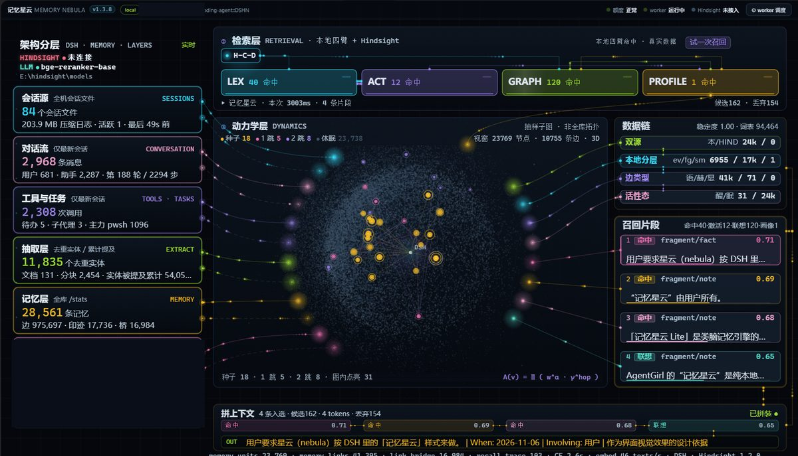

# Nebula Memory

> **零依赖 · 纯本地 · 可视化的 Agent 记忆系统。装完即用，不花钱，不上云。**

一个自包含的记忆引擎：**本地 JSONL 四臂召回**（词法 / 激活 / 图扩散 / 画像）+ **可交互的记忆星云可视化面板**，可选叠加 **Hindsight HTTP API** 做语义增强。核心引擎永远可独立运行——**不联网、不烧钱、不依赖任何数据库或 LLM**。

[](#license)
[](#)

> **🚀 小白想直接用？看 [快速上手（保姆级教程）](docs/快速上手.md)** —— 不写代码，跟着做就能用上。
>
> **🖥 你在用 DeepSeek Harness（DSH）？直接把本仓库地址发给 DSH，让它帮你装**（见 [安装到 DSH](#安装到-dsh)）。



---

## 为什么是它

市面上的 Agent 记忆框架（[Mem0](https://github.com/mem0ai/mem0)、[Zep](https://github.com/getzep/zep)、腾讯 [TencentDB Agent Memory](https://github.com/Tencent/TencentDB-Agent-Memory) 等）普遍**很重**——要 Postgres / MongoDB / 向量库、要云端 LLM、要部署脚本、每次对话都在烧钱、数据要上云。

**Nebula Memory 走相反的路线**：

| | 重型框架（Mem0/Zep/腾讯） | Nebula Memory |
|---|---|---|
| 依赖 | 数据库 + 向量库 + LLM | **零依赖（纯 Node.js）** |
| 部署 | 多步、要配置 | **一条命令 / 一个 import** |
| 成本 | 每次对话烧钱 | **零成本（纯本地）** |
| 隐私 | 数据上云 | **数据不出本机** |
| 体积 | 几十 MB 起步 | **~160 KB** |
| 可视化 | 通常没有 | **记忆星云面板（3D 星图 + 召回轨迹）** |

一句话：**重型框架是「企业记忆中台」，Nebula Memory 是「个人开发者的零依赖记忆」**。

---

## 特性

- 🔌 **零依赖**：纯 Node.js + JSONL 文件，没有 npm 依赖、没有数据库、没有向量库
- 🏠 **本地优先**：记忆存在你自己的机器上，不联网、不上云、不泄露
- 🧠 **四臂召回**：词法（TF-IDF）· 激活（FSRS 遗忘曲线）· 图扩散（2 跳）· 画像，本地就能做语义相关的记忆检索
- 🎨 **可视化面板**：记忆星云 3D 星图、数据链、召回轨迹、SSE 实时刷新
- ⚡ **快**：冷启动 ~2.9s，召回延迟压到本地保底
- 🧩 **可叠加增强**：可选接 Hindsight HTTP API 做 LLM 语义检索（不装也完全能用）
- 📌 **置顶永固**：`importance=1.0` 的关键事实（API 密钥、称呼偏好）永不受时间衰减

---

## Quick Start（5 行跑通）

```bash
git clone https://github.com/yb-zhai/agent-memory.git
```

```javascript
import { NebulaMemory } from './agent-memory/memory/index.mjs'

const memory = new NebulaMemory({ dir: './my-memory' })
await memory.remember('老板喜欢喝冰美式')
await memory.remember('这个项目的 API 密钥是 sk-xxx', { importance: 1.0 })  // 置顶，永不遗忘
const context = await memory.recall('老板喝什么？')   // → 命中「冰美式」
```

> 完全不需要配置 Postgres、不需要 API Key、不需要联网。跑完上面这段，你的 Agent 就有了记忆。
>
> **引擎与模型无关**：`NebulaMemory` 是纯 Node.js 模块，任何 Agent（Claude / GPT / 文心 / 通义 / 自研模型）都能用——把它召回的记忆塞进 prompt 即可。

### 想用语义增强？

本地四臂已经能解决大部分记忆召回。如果你想要更强的语义检索，可以叠加 **Hindsight HTTP API**（可选），见 [Hindsight 叠加](#hindsight-叠加可选)。

---

## 截图

<!-- TODO: 放一张记忆星云面板的截图或 GIF，这是最打动人的部分 -->
<!-- 建议录制：输入一句话 → 面板上节点瞬间点亮 → 召回卡片出现 -->

---

## 安装 / 接入方式

Nebula Memory 有三种用法，按需选择：

### 1. 作为库（Node.js，任何模型可用）

```bash
git clone https://github.com/yb-zhai/agent-memory.git
```

```javascript
import { NebulaMemory } from './agent-memory/memory/index.mjs'
const memory = new NebulaMemory({ dir: './memory' })
await memory.init()
await memory.remember('...')
await memory.recall('...')
```

> 引擎是纯 Node.js、零依赖、与模型无关——把它召回的记忆塞进任意模型的 prompt 即可。

### 2. 作为独立 HTTP 服务

```bash
node server.js
```

启动后监听 `127.0.0.1:8898`，暴露 REST API（`/recall`、`/remember`、`/state`、`/graph` 等）和 SSE 实时推流。任何语言（Python / JS / 其他）都能用 `requests` / `fetch` 调用。

### 3. 作为 MCP Server（接入 Claude / Cursor / ChatGPT / Grok / Gemini 等）

```json
{
  "mcpServers": {
    "agent-memory": {
      "command": "node",
      "args": ["C:\\path\\to\\agent-memory\\mcp-server.mjs"]
    }
  }
}
```

写一个 MCP Server，就同时接入了 **Claude、Cursor、ChatGPT、Grok、Gemini、Windsurf、Cline** 等所有支持 MCP 的主流 AI 客户端——它们都能直接读写你的记忆。**当前为纯本地版**（零依赖、零花费），Hindsight 语义增强版后续跟进。详见 [docs/MCP.md](docs/MCP.md) 或 [小白版快速上手](docs/快速上手.md)。

### 4. 作为 DSH 插件（可视化面板）

如果你用 [DeepSeek Harness](https://github.com/deepseek-ai/DeepSeek)（DSH），可以把它作为插件安装，获得完整的「记忆星云」可视化面板。见 [安装到 DSH](#安装到-dsh)。

---

## API 一览

| 方法 | 作用 |
|---|---|
| `memory.remember(input)` | 写入一条记忆 |
| `memory.recall(query)` | 四臂召回 |
| `memory.observe(input)` | 观察一条（记录但不主动召回） |
| `memory.forget(id)` | 删除一条 |
| `memory.stats()` | 统计（节点/边数量） |
| `memory.consolidate()` | 巩固（相似片段合并、衰减） |

---

## 架构

```
┌──────────────────────────────────────────┐
│            Nebula Memory 引擎              │
│  （零依赖 JSONL · 四臂召回 · FSRS 动力学） │
├──────────────────────────────────────────┤
│  ├─ 本地四臂：词法 / 激活 / 图扩散 / 画像  │
│  └─ 可选叠加：Hindsight HTTP API（语义）   │
└──────────────────────────────────────────┘
```

核心引擎**永远可独立运行**；Hindsight 只是「可选的增强」，不是「必需的前置」。探测不到 Hindsight 就自动降级纯本地，不报错、不伪造数据。

---

## 关于「语义增强（Hindsight）」

> **这一节专门说清楚：为什么你现在用不到它，以及以后会怎样。**

### 一句话解释

Nebula Memory 有两档能力：

| 档位 | 是什么 | 现在能用到吗 |
|---|---|---|
| **本地四臂（默认）** | 词法 + 激活 + 图扩散 + 画像，纯本地、零依赖、零成本 | ✅ **开箱即用**，这就是你装完就能用的东西 |
| **语义增强（Hindsight）** | 额外的 LLM 语义检索，召回更"懂意思" | ❌ **暂未提供**，原因见下 |

### 为什么「语义增强」现在没开源？

它不是一个"文件"或"一行配置"，而是一整套**独立的重型系统**：

- 需要一个 **Postgres 数据库**；
- 需要一个 **LLM**（要花钱调 API）；
- 还需要 **worker 后台调度 + 额度熔断** 等一整套运维；
- 整套体积很大（模型文件就几个 GB）。

**把它塞进安装包，会破坏这个项目最核心的优点——「零依赖、装完即用、不花钱」。**

所以现在的策略是：**先只开放「本地四臂」这一档**，它已经能解决大部分 Agent 记忆需求，而且是零依赖、零成本的。

### 以后会怎样？（Roadmap）

插件**已经预留了接口**（`HINDSIGHT_URL` 环境变量）——如果你自己恰好有一套兼容的 Hindsight 服务，填上地址就能自动叠加（每 30 秒探测一次，`local` ↔ `hybrid` 自动切换）。

**标准安装暂不含 Hindsight**。等我们把「语义增强」做成更轻、更容易装的形式（比如轻量 embedding，或云端服务），再提供给大家。

> **放心用本地四臂就行**：它零依赖、零成本、装完即用，是这个项目当前最可靠、最值得用的部分。

---

## 安装到 DSH

如果你在用 [DeepSeek Harness](https://github.com/deepseek-ai/DeepSeek)（DSH），可以安装这个插件，获得完整的「记忆星云」可视化面板。

### 最省事的方式：让 DSH 帮你装

**直接把本仓库地址发给 DSH，对它说：**

> 帮我安装这个插件：https://github.com/yb-zhai/agent-memory

DSH 会自己 clone 仓库、运行 `install.ps1`、装好并告诉你结果。

### 手动安装（如果你更想自己来）

```powershell
# 1. 下载仓库
git clone https://github.com/yb-zhai/agent-memory.git
cd agent-memory

# 2. 运行安装脚本
powershell -NoProfile -ExecutionPolicy Bypass -File .\install.ps1
```

安装器会**自动完成**：备份旧版本 → 替换代码 → 健康检查 → 失败自动回滚。**不丢记忆数据。**

装完后，在 DSH 左侧栏「更多」里打开「记忆星云」即可看到面板。

> 前置：需要已安装 Node.js（DSH 通常自带）；安装器会读 `%DSH_HOME%` 定位到你的 DSH 环境。

---

## 数据与隐私

- **本地 JSONL**：`nodes.jsonl` / `edges.jsonl` / `index.json` / `trace.jsonl`，全在你自己的机器上；
- **不上云、不联网**：纯本地模式零网络请求；
- **密钥加密**：API Key 用 Windows DPAPI 加密存储，绝不写入日志或明文导出；
- **不收集数据**：没有埋点、没有遥测。

详见 [SECURITY.md](SECURITY.md)。

---

## 许可

[MIT License](LICENSE) © 2026 yb-zhai

---

## 致谢

- 记忆引擎内核源自 [NebulaMemory](https://github.com/deepseek-ai/DeepSeek)（DSH 挂件侧），经重构独立为通用记忆引擎。
