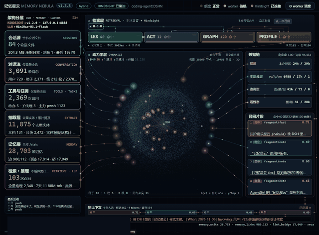

# Nebula Memory

> **闆朵緷璧?路 绾湰鍦?路 鍙鍖栫殑 Agent 璁板繂绯荤粺銆傝瀹屽嵆鐢紝涓嶈姳閽憋紝涓嶄笂浜戙€?*

涓€涓嚜鍖呭惈鐨勮蹇嗗紩鎿庯細**鏈湴 JSONL 鍥涜噦鍙洖**锛堣瘝娉?/ 婵€娲?/ 鍥炬墿鏁?/ 鐢诲儚锛? **鍙氦浜掔殑璁板繂鏄熶簯鍙鍖栭潰鏉?*锛屽彲閫夊彔鍔?**Hindsight HTTP API** 鍋氳涔夊寮恒€傛牳蹇冨紩鎿庢案杩滃彲鐙珛杩愯鈥斺€?*涓嶈仈缃戙€佷笉鐑ч挶銆佷笉渚濊禆浠讳綍鏁版嵁搴撴垨 LLM**銆?
[](#license)
[](#)

> **馃殌 灏忕櫧鎯崇洿鎺ョ敤锛熺湅 [蹇€熶笂鎵嬶紙淇濆绾ф暀绋嬶級](docs/蹇€熶笂鎵?md)** 鈥斺€?涓嶅啓浠ｇ爜锛岃窡鐫€鍋氬氨鑳界敤涓娿€?>
> **馃枼 浣犲湪鐢?DeepSeek Harness锛圖SH锛夛紵鐩存帴鎶婃湰浠撳簱鍦板潃鍙戠粰 DSH锛岃瀹冨府浣犺**锛堣 [瀹夎鍒?DSH](#瀹夎鍒?dsh)锛夈€?


*璁板繂鏄熶簯闈㈡澘瀹炴椂鍔ㄧ敾锛氭槦浜戠矑瀛愬懠鍚?路 鍙洖鍗＄墖杞崲鐐逛寒 路 鍥涜噦鍛戒腑 路 鏁版嵁閾惧疄鏃跺埛鏂?

---

## 涓轰粈涔堟槸瀹?
> **Works 100% offline. Zero dependencies. No API keys required.**
> 100% 绂荤嚎杩愯 路 闆朵緷璧?路 鏃犻渶浠讳綍 API Key銆?
甯傞潰涓婄殑 Agent 璁板繂妗嗘灦锛圼Mem0](https://github.com/mem0ai/mem0)銆乕Zep](https://github.com/getzep/zep)銆佽吘璁?[TencentDB Agent Memory](https://github.com/Tencent/TencentDB-Agent-Memory) 绛夛級鏅亶**寰堥噸**鈥斺€旇 Postgres / MongoDB / 鍚戦噺搴撱€佽浜戠 LLM銆佽閮ㄧ讲鑴氭湰銆佹瘡娆″璇濋兘鍦ㄧ儳閽便€佹暟鎹涓婁簯銆?
**Nebula Memory 璧扮浉鍙嶇殑璺嚎**锛?
| | 閲嶅瀷妗嗘灦锛圡em0/Zep/鑵捐锛?| Nebula Memory |
|---|---|---|
| 渚濊禆 | 鏁版嵁搴?+ 鍚戦噺搴?+ LLM | **闆朵緷璧栵紙绾?Node.js锛?* |
| 閮ㄧ讲 | 澶氭銆佽閰嶇疆 | **涓€鏉″懡浠?/ 涓€涓?import** |
| 鎴愭湰 | 姣忔瀵硅瘽鐑ч挶 | **闆舵垚鏈紙绾湰鍦帮級** |
| 闅愮 | 鏁版嵁涓婁簯 | **鏁版嵁涓嶅嚭鏈満** |
| 浣撶Н | 鍑犲崄 MB 璧锋 | **~160 KB** |
| 鍙鍖?| 閫氬父娌℃湁 | **璁板繂鏄熶簯闈㈡澘锛?D 鏄熷浘 + 鍙洖杞ㄨ抗锛?* |

涓€鍙ヨ瘽锛?*閲嶅瀷妗嗘灦鏄€屼紒涓氳蹇嗕腑鍙般€嶏紝Nebula Memory 鏄€屼釜浜哄紑鍙戣€呯殑闆朵緷璧栬蹇嗐€?*銆?
### 鍏充簬銆屾柇缃戝彲鐢ㄣ€嶇殑鍑嗙‘鍚箟

缁忓父鏈変汉闂細"AI 妯″瀷涓嶆槸瑕佽仈缃戣皟 API 鍚楋紝鏂綉鎬庝箞鐢紵" 杩欓噷瑕佸垎娓呴摼璺噷鐨?*涓や釜鐙珛閮ㄥ垎**锛?
```
浣犵殑闂
  鈹溾攢 鈶?璁板繂绯荤粺锛堟湰椤圭洰锛夛細浠庢湰鍦板簱鎵惧嚭鐩稿叧璁板繂銆佹嫾鎴愪笂涓嬫枃   鈫?鏂綉鍙敤 鉁?  鈹斺攢 鈶?AI 澶фā鍨嬶細鎶婁笂涓嬫枃鍐欐垚閫氶『鍥炵瓟                      鈫?浜?API 闇€鑱旂綉 鉂?/ 鏈湴妯″瀷鍙敤 鉁?```

- **鏈」鐩殑閮ㄥ垎锛堚憼锛夌‘瀹炴柇缃戝彲鐢?*锛氳蹇嗗瓨鏈湴 JSONL锛屾绱㈤潬璇嶉 + 鍊掓帓绱㈠紩 + 鍥炬墿鏁ｏ紝**鍏ㄧ▼涓嶈仈缃戙€佷笉璋冩ā鍨嬨€佷笉鐑?token**銆傛柇缃戞椂渚濈劧鑳藉彫鍥炵浉鍏宠蹇嗐€佹嫾濂戒笂涓嬫枃銆?- **AI 鐢熸垚鍥炵瓟锛堚憽锛?* 鏄ā鍨嬫湰韬殑浜嬶細鐢?Claude / ChatGPT 绛変簯 API 鏃堕渶瑕佽仈缃戯紱鎯炽€屽畬鍏ㄧ绾裤€嶏紝缁欒繖涓€姝ラ厤涓湰鍦版ā鍨嬶紙Ollama / llama.cpp 绛夛級鍗冲彲鈥斺€旀湰椤圭洰瀵瑰鍙繑鍥炰笂涓嬫枃鏂囨湰锛岃皝鏉ョ敓鎴愬洖绛旈兘琛屻€?
> 鎵€浠ャ€屾柇缃戝彲鐢ㄣ€嶆寚鐨勬槸**璁板繂鐨勫瓨鍙栦笌鍙洖**锛屼笉鏄寚 AI 妯″瀷鑳芥柇缃戞€濊€冦€?
### 鍧﹁瘹瀵规瘮锛氫綘璇ラ€夊摢涓紵

- 鎯宠**寮€绠卞嵆鐢ㄧ殑浜戝師鐢熸墭绠¤蹇?* 鈫?鐢?[TencentDB Agent Memory](https://github.com/Tencent/TencentDB-Agent-Memory) 鎴?[Mem0](https://github.com/mem0ai/mem0)锛?- 鎯宠**鏂逛究鎺ュ叆 Python 鐢熸€?* 鈫?鐢?LangChain Memory锛?- 鎯宠涓€涓?*瀹屽叏灞炰簬鑷繁銆佷笉鑺变竴鍒嗛挶 Token銆佹柇缃戜篃鑳界敤銆佺敋鑷宠兘鍦ㄦ爲鑾撴淳涓婅窇璧锋潵**鐨勬瀬瀹㈢骇璁板繂寮曟搸 鈫?**鐢?Nebula Memory**銆?
> **鏈湴鍥涜噦妯″紡宸茶冻澶熸弧瓒虫棩甯歌蹇嗛渶姹?*锛孒indsight 璇箟澧炲己鏄繘闃跺彲閫夛紙瑙?[鍏充簬璇箟澧炲己](#鍏充簬璇箟澧炲己hindsight)锛夈€?
---

## 鐗规€?
- 馃攲 **闆朵緷璧?*锛氱函 Node.js + JSONL 鏂囦欢锛屾病鏈?npm 渚濊禆銆佹病鏈夋暟鎹簱銆佹病鏈夊悜閲忓簱
- 馃彔 **鏈湴浼樺厛**锛氳蹇嗗瓨鍦ㄤ綘鑷繁鐨勬満鍣ㄤ笂锛屼笉鑱旂綉銆佷笉涓婁簯銆佷笉娉勯湶
- 馃 **鍥涜噦鍙洖**锛氳瘝娉曪紙TF-IDF锛壜?婵€娲伙紙FSRS 閬楀繕鏇茬嚎锛壜?鍥炬墿鏁ｏ紙2 璺筹級路 鐢诲儚锛屾湰鍦板氨鑳藉仛璇箟鐩稿叧鐨勮蹇嗘绱?- 馃帹 **鍙鍖栭潰鏉?*锛氳蹇嗘槦浜?3D 鏄熷浘銆佹暟鎹摼銆佸彫鍥炶建杩广€丼SE 瀹炴椂鍒锋柊
- 鈿?**蹇?*锛氬喎鍚姩 ~2.9s锛?*绾湰鍦板彫鍥炲疄娴嬪钩鍧?28.8ms / 涓綅鏁?23.9ms / 鏈€鎱?69.4ms**锛堢函鍐呭瓨璁＄畻锛屾绉掔骇锛岃瑙乕浼樺寲鎶ュ憡](docs/浼樺寲鎶ュ憡-2026-11-21.md)锛?- 馃З **鍙彔鍔犲寮?*锛氬彲閫夋帴 Hindsight HTTP API 鍋?LLM 璇箟妫€绱紙涓嶈涔熷畬鍏ㄨ兘鐢級
- 馃搶 **缃《姘稿浐**锛歚importance=1.0` 鐨勫叧閿簨瀹烇紙API 瀵嗛挜銆佺О鍛煎亸濂斤級姘镐笉鍙楁椂闂磋“鍑?
---

## Quick Start锛? 琛岃窇閫氾級

```bash
git clone https://github.com/yb-zhai/agent-memory.git
```

```javascript
import { NebulaMemory } from './agent-memory/memory/index.mjs'

const memory = new NebulaMemory({ dir: './my-memory' })
await memory.remember('鑰佹澘鍠滄鍠濆啺缇庡紡')
await memory.remember('杩欎釜椤圭洰鐨?API 瀵嗛挜鏄?sk-xxx', { importance: 1.0 })  // 缃《锛屾案涓嶉仐蹇?const context = await memory.recall('鑰佹澘鍠濅粈涔堬紵')   // 鈫?鍛戒腑銆屽啺缇庡紡銆?```

> 瀹屽叏涓嶉渶瑕侀厤缃?Postgres銆佷笉闇€瑕?API Key銆佷笉闇€瑕佽仈缃戙€傝窇瀹屼笂闈㈣繖娈碉紝浣犵殑 Agent 灏辨湁浜嗚蹇嗐€?>
> **寮曟搸涓庢ā鍨嬫棤鍏?*锛歚NebulaMemory` 鏄函 Node.js 妯″潡锛屼换浣?Agent锛圕laude / GPT / 鏂囧績 / 閫氫箟 / 鑷爺妯″瀷锛夐兘鑳界敤鈥斺€旀妸瀹冨彫鍥炵殑璁板繂濉炶繘 prompt 鍗冲彲銆?
### 鎯崇敤璇箟澧炲己锛?
鏈湴鍥涜噦宸茬粡鑳借В鍐冲ぇ閮ㄥ垎璁板繂鍙洖銆傚鏋滀綘鎯宠鏇村己鐨勮涔夋绱紝鍙互鍙犲姞 **Hindsight HTTP API**锛堝彲閫夛級锛岃 [Hindsight 鍙犲姞](#hindsight-鍙犲姞鍙€?銆?
---

## 鎴浘

<!-- TODO: 鏀句竴寮犺蹇嗘槦浜戦潰鏉跨殑鎴浘鎴?GIF锛岃繖鏄渶鎵撳姩浜虹殑閮ㄥ垎 -->
<!-- 寤鸿褰曞埗锛氳緭鍏ヤ竴鍙ヨ瘽 鈫?闈㈡澘涓婅妭鐐圭灛闂寸偣浜?鈫?鍙洖鍗＄墖鍑虹幇 -->

---

## 瀹夎 / 鎺ュ叆鏂瑰紡

Nebula Memory 鏈変笁绉嶇敤娉曪紝鎸夐渶閫夋嫨锛?
### 1. 浣滀负搴擄紙Node.js锛屼换浣曟ā鍨嬪彲鐢級

```bash
git clone https://github.com/yb-zhai/agent-memory.git
```

```javascript
import { NebulaMemory } from './agent-memory/memory/index.mjs'
const memory = new NebulaMemory({ dir: './memory' })
await memory.init()
await memory.remember('...')
await memory.recall('...')
```

> 寮曟搸鏄函 Node.js銆侀浂渚濊禆銆佷笌妯″瀷鏃犲叧鈥斺€旀妸瀹冨彫鍥炵殑璁板繂濉炶繘浠绘剰妯″瀷鐨?prompt 鍗冲彲銆?
### 2. 浣滀负鐙珛 HTTP 鏈嶅姟

```bash
node server.js
```

鍚姩鍚庣洃鍚?`127.0.0.1:8898`锛屾毚闇?REST API锛坄/recall`銆乣/remember`銆乣/state`銆乣/graph` 绛夛級鍜?SSE 瀹炴椂鎺ㄦ祦銆備换浣曡瑷€锛圥ython / JS / 鍏朵粬锛夐兘鑳界敤 `requests` / `fetch` 璋冪敤銆?
### 3. 浣滀负 MCP Server锛堟帴鍏?Claude / Cursor / ChatGPT / Grok / Gemini 绛夛級

**鏈€鐪佷簨锛氱敤 npm 鍖咃紝涓€鏉?`npx` 鍛戒护锛屼笉鐢?clone 浠撳簱銆佷笉鐢ㄨ渚濊禆锛?*

```json
{
  "mcpServers": {
    "nebula-memory": {
      "command": "npx",
      "args": ["-y", "nebula-memory-mcp@latest"],
      "env": { "NEBULA_DATA_DIR": "/path/to/your/memory" }
    }
  }
}
```

鍖呭湴鍧€锛歔nebula-memory-mcp on npm](https://www.npmjs.com/package/nebula-memory-mcp) 路 闆朵緷璧?路 49KB銆?
鍐欎竴涓?MCP Server锛屽氨鍚屾椂鎺ュ叆浜?**Claude銆丆ursor銆丆hatGPT銆丟rok銆丟emini銆乄indsurf銆丆line** 绛夋墍鏈夋敮鎸?MCP 鐨勪富娴?AI 瀹㈡埛绔€斺€斿畠浠兘鑳界洿鎺ヨ鍐欎綘鐨勮蹇嗐€?*褰撳墠涓虹函鏈湴鐗?*锛堥浂渚濊禆銆侀浂鑺辫垂锛夛紝Hindsight 璇箟澧炲己鐗堝悗缁窡杩涖€傝瑙?[docs/MCP.md](docs/MCP.md) 鎴?[灏忕櫧鐗堝揩閫熶笂鎵媇(docs/蹇€熶笂鎵?md)銆?
> 鎯崇敤婧愮爜鏂瑰紡锛堣€岄潪 npm 鍖咃級锛歚command` 濉?`node`锛宍args` 濉?`["璺緞/mcp-server.mjs"]` 鍗冲彲銆?
**瑁呭畬鎬庝箞鐢紵** MCP 鏄悗鍙板伐鍏凤紝AI 涓嶄細鑷姩鐢ㄢ€斺€旂洿鎺ヨ銆?*璁颁綇锛歺xx**銆嶅瓨璁板繂锛岃銆?*鎴戜箣鍓嶈杩?xxx 鍚楋紵**銆嶅彇璁板繂銆傚鏋?AI 璇存病杩欏伐鍏凤紝鎻愰啋瀹冧竴鍙ャ€屼綘鏈?nebula-memory 鐨?MCP 宸ュ叿锛岀敤 remember/recall銆嶅嵆鍙€傝瑙?[蹇€熶笂鎵嬬 6 姝(docs/蹇€熶笂鎵?md)銆?
### 澶?Agent 鍏变韩璁板繂

涓€濂楄蹇嗭紝**鎵€鏈?Agent 鍏变韩**鈥斺€旇繖鏄?MCP 鏋舵瀯鏈€鑷劧鐨勭敤娉曘€?
```
NebulaMemory锛堜竴涓簱锛?  鈹斺攢 MCP Server锛堜竴涓繘绋嬶級
       鈹溾攢 Claude Desktop   璁板繂浜掗€?       鈹溾攢 Cursor           璁板繂浜掗€?       鈹溾攢 ChatGPT          璁板繂浜掗€?       鈹斺攢 Windsurf / Cline 璁板繂浜掗€?```

**鍋氭硶**锛氳澶氫釜 AI 瀹㈡埛绔帴鍏?*鍚屼竴涓?MCP Server銆佹寚鍚戝悓涓€涓?`NEBULA_DATA_DIR`**鈥斺€擟laude 璁颁綇鐨勪笢瑗匡紝Cursor 涓嬫灏辫兘鏌ュ埌銆傞浂鏀归€犮€佸嵆閰嶅嵆鐢ㄣ€?
```json
{
  "mcpServers": {
    "nebula-memory": {
      "command": "npx",
      "args": ["-y", "nebula-memory-mcp@latest"],
      "env": { "NEBULA_DATA_DIR": "/path/鍏变韩鐨勮蹇嗙洰褰? }
    }
  }
}
```

> 姣忎釜瀹㈡埛绔殑 MCP 閰嶇疆閲屽～**鐩稿悓鐨?`NEBULA_DATA_DIR`**锛屽氨鏄叡浜悓涓€浠借蹇嗐€?
**鍑犵偣璇存槑**锛?
| 鍦烘櫙 | 鏀寔鍚?|
|---|---|
| 澶氫釜 AI 瀹㈡埛绔粡 MCP 鍏变韩涓€涓簱 | 鉁?鎺ㄨ崘锛屾渶绋?|
| 澶氫釜鐙珛杩涚▼鍚屾椂璇诲啓涓€涓簱 | 鈿狅笍 杩藉姞鏄師瀛愮殑銆佽兘鐢紝浣嗗悇杩涚▼鎶婂簱鍔犺浇杩涘唴瀛橈紝**鐪嬩笉鍒板郊姝ょ殑瀹炴椂鏇存柊**锛堥渶閲嶅惎鍚屾锛夛紱鍚屾椂璺戝帇缂╀細鍐茬獊锛屼笉寤鸿閲嶅害骞跺彂 |
| 鍚?Agent 鐙珛搴撱€佷簰鐩告煡璇?| 鉂?鏆備笉鏀寔锛堝搴撹矾鐢卞睘鍚庣画鍔熻兘锛?|

### 4. 浣滀负 DSH 鎻掍欢锛堝彲瑙嗗寲闈㈡澘锛?
濡傛灉浣犵敤 [DeepSeek Harness](https://github.com/deepseek-ai/DeepSeek)锛圖SH锛夛紝鍙互鎶婂畠浣滀负鎻掍欢瀹夎锛岃幏寰楀畬鏁寸殑銆岃蹇嗘槦浜戙€嶅彲瑙嗗寲闈㈡澘銆傝 [瀹夎鍒?DSH](#瀹夎鍒?dsh)銆?
---

## API 涓€瑙?
| 鏂规硶 | 浣滅敤 |
|---|---|
| `memory.remember(input)` | 鍐欏叆涓€鏉¤蹇?|
| `memory.recall(query)` | 鍥涜噦鍙洖 |
| `memory.observe(input)` | 瑙傚療涓€鏉★紙璁板綍浣嗕笉涓诲姩鍙洖锛?|
| `memory.forget(id)` | 鍒犻櫎涓€鏉?|
| `memory.stats()` | 缁熻锛堣妭鐐?杈规暟閲忥級 |
| `memory.consolidate()` | 宸╁浐锛堢浉浼肩墖娈靛悎骞躲€佽“鍑忥級 |

---

## 鏋舵瀯

```
鈹屸攢鈹€鈹€鈹€鈹€鈹€鈹€鈹€鈹€鈹€鈹€鈹€鈹€鈹€鈹€鈹€鈹€鈹€鈹€鈹€鈹€鈹€鈹€鈹€鈹€鈹€鈹€鈹€鈹€鈹€鈹€鈹€鈹€鈹€鈹€鈹€鈹€鈹€鈹€鈹€鈹€鈹€鈹?鈹?           Nebula Memory 寮曟搸              鈹?鈹? 锛堥浂渚濊禆 JSONL 路 鍥涜噦鍙洖 路 FSRS 鍔ㄥ姏瀛︼級 鈹?鈹溾攢鈹€鈹€鈹€鈹€鈹€鈹€鈹€鈹€鈹€鈹€鈹€鈹€鈹€鈹€鈹€鈹€鈹€鈹€鈹€鈹€鈹€鈹€鈹€鈹€鈹€鈹€鈹€鈹€鈹€鈹€鈹€鈹€鈹€鈹€鈹€鈹€鈹€鈹€鈹€鈹€鈹€鈹?鈹? 鈹溾攢 鏈湴鍥涜噦锛氳瘝娉?/ 婵€娲?/ 鍥炬墿鏁?/ 鐢诲儚  鈹?鈹? 鈹斺攢 鍙€夊彔鍔狅細Hindsight HTTP API锛堣涔夛級   鈹?鈹斺攢鈹€鈹€鈹€鈹€鈹€鈹€鈹€鈹€鈹€鈹€鈹€鈹€鈹€鈹€鈹€鈹€鈹€鈹€鈹€鈹€鈹€鈹€鈹€鈹€鈹€鈹€鈹€鈹€鈹€鈹€鈹€鈹€鈹€鈹€鈹€鈹€鈹€鈹€鈹€鈹€鈹€鈹?```

鏍稿績寮曟搸**姘歌繙鍙嫭绔嬭繍琛?*锛汬indsight 鍙槸銆屽彲閫夌殑澧炲己銆嶏紝涓嶆槸銆屽繀闇€鐨勫墠缃€嶃€傛帰娴嬩笉鍒?Hindsight 灏辫嚜鍔ㄩ檷绾х函鏈湴锛屼笉鎶ラ敊銆佷笉浼€犳暟鎹€?
---

## 甯歌闂锛團AQ锛?
### Q锛氱敤銆屽瓧鍏稿紡绮剧‘绱㈠紩銆嶅氨澶熶簡锛屼负浠€涔堣鍥涜噦鍙洖锛?
瀛楀吀寮忥紙key 鈫?value 绮剧‘鏌ユ壘锛夊叾瀹炲氨鏄洓鑷傞噷鐨?**LEX 鑷?*鈥斺€斿€掓帓绱㈠紩绮剧‘鍖归厤锛?*璁板緱 key 鏃跺畠鏈€蹇渶鐪侊紝宸茬粡鍐呯疆**銆?
澶氬嚭鏉ョ殑涓夎噦锛堟縺娲?/ 鍥炬墿鏁?/ 鐢诲儚锛変笉鏄浛浠ｅ瓧鍏革紝鑰屾槸瑕嗙洊銆?*璁颁笉浣?key**銆嶇殑鎯呭喌锛?
- 瀛楀吀寮忥細璁板緱銆?1 鏈?20 鍙烽偅涓姤閿欍€嶁啋 绉掓煡锛?- 妯＄硦鍙洖锛氬彧璁板緱銆屼笂娆￠偅涓鍣ㄦ姤閿欐€庝箞瑙ｅ喅鐨勩€嶏紝涓嶈寰楀摢澶┿€佷粈涔堣瘝 鈫?瀛楀吀娌?key 鍙煡锛岄潬鍥炬墿鏁?婵€娲绘壘鍒般€?
**濡傛灉浣犵殑璁板繂閮芥槸鎸夋棩鏈熺簿纭綊妗ｃ€佷綘涔熻寰椾綇 key锛屽瓧鍏哥‘瀹炲鐢?*銆傚洓鑷傛槸涓恒€孉I 瑕佽嚜宸辨兂璧峰畠蹇樹簡鐨勪笢瑗裤€嶅噯澶囩殑銆?
### Q锛氭渶缁堣〃鐜板拰鑵捐閭ｇ甯?70M 鍚戦噺妯″瀷鐨?memory 鏈夊尯鍒悧锛?
鏈€缁堣〃鐜伴兘鏄€孉I 璁拌捣鏉ャ€嶏紝宸埆鍦?*浠ｄ环鍜岃竟鐣?*锛?
| | 閲嶅瀷鏂规锛堣吘璁?Mem0 绛夛級 | Nebula Memory |
|---|---|---|
| 渚濊禆 | 70M 鍚戦噺妯″瀷 + 鐢熸€?/ 鏁版嵁搴?| 闆朵緷璧栥€?60KB |
| 鎴愭湰 | 瑕佽祫婧愩€佸彲鑳界儳 token | 绾湰鍦伴浂鎴愭湰 |
| 闅愮 | 鏁版嵁鍙兘涓婁簯 | 鏁版嵁涓嶅嚭鏈満 |
| 绂荤嚎 | 渚濊禆妯″瀷/鏈嶅姟 | **鏂綉鐓ф牱璺?* |

鑳藉仛鍒颁竴鏍风殑琛ㄧ幇銆佸嵈涓嶇敤閭ｅ閲嶈祫浜э紝姝ｆ槸瀹冨瓨鍦ㄧ殑鎰忎箟銆?
### Q锛氳蹇嗗簱瀛樼殑鏄師鏂囪繕鏄悜閲忥紵

- **鏈湴鍥涜噦锛堥粯璁ゃ€佸紑婧愮殑閮ㄥ垎锛?*锛氬瓨**鍘熸枃**锛圝SONL 鐨?`text`锛夛紝妫€绱㈤潬**璇嶉/鍊掓帓绱㈠紩锛圱F-IDF锛岀█鐤忓悜閲忥級+ 鍥剧粨鏋?*銆備唬鐮侀噷铏芥湁涓?`vec` 瀛楁锛屼絾閭ｅ彧鏄粰澶栭儴閫忎紶棰勭暀鐨勶紝**鍙洖绠楁硶瀹屽叏涓嶇敤瀹?*鈥斺€旀病鏈?embedding 妯″瀷銆佷笉鐑?token銆侀浂渚濊禆銆?- **Hindsight 璇箟澧炲己锛堝彲閫夈€佹殏鏈紑婧愶級**锛氶偅涓€灞傛墠鐢ㄧ湡路AI 鍚戦噺鍋氳涔夋绱紝浣嗚 Postgres + LLM锛屾湁鎴愭湰銆?
### Q锛欰I 妯″瀷涓嶆槸瑕佽仈缃戝悧锛熴€屾柇缃戝彲鐢ㄣ€嶆槸浠€涔堟剰鎬濓紵

瑙?[鍏充簬銆屾柇缃戝彲鐢ㄣ€嶇殑鍑嗙‘鍚箟](#鍏充簬鏂綉鍙敤鐨勫噯纭惈涔?銆傜畝鐭锛?*璁板繂鐨勫瓨鍙栦笌鍙洖鏂綉鍙敤**锛堟湰鍦版枃浠?+ 璇嶉妫€绱紝涓嶈仈缃戜笉鐑?token锛夛紱**AI 鐢熸垚鍥炵瓟**鐢ㄤ簯 API 闇€鑱旂綉锛屾兂鍏ㄧ绾块厤涓湰鍦版ā鍨嬶紙Ollama 绛夛級鍗冲彲銆?
### Q锛氭帴浜?MCP 涔嬪悗锛宼oken 寮€閿€鎬庝箞绠楋紵

璇氬疄璇存竻妤氾紝涓嶅じ澶с€岄浂鎴愭湰銆嶏細

- **鏈湴鍙洖鏈韩闆?token**锛氳瘝棰?+ 鍊掓帓 + 鍥炬墿鏁ｏ紝绾湰鍦拌绠楋紝涓嶈仈缃戙€佷笉璋冩ā鍨嬶紱
- **MCP 宸ュ叿鏈夊浐瀹氬紑閿€**锛氫綔涓?MCP 宸ュ叿鎺ュ叆鍚庯紝宸ュ叿璇存槑涔︼紙schema锛変細甯搁┗妯″瀷涓婁笅鏂囷紝绾?**1~2k token/杞?*鈥斺€旇繖鏄?*鎵€鏈?MCP 宸ュ叿鐨勯€氱敤鐜拌薄**锛屼笉鏄湰椤圭洰鐗规湁锛?- **鍙洖鍐呭鍗犲皯閲?token**锛氭壘鍥炵殑璁板繂浼氭嫾杩?prompt锛屾崲鏉ョ殑鏄€屼笉鐢ㄦ瘡杞噸璇绘暣娈靛巻鍙层€嶃€?
涓€鍙ヨ瘽锛?*鐢ㄤ竴鐐?token 鎹€孉I 璁板緱浣犮€?*锛屼笉鏄浂鎴愭湰锛屼絾鐪佺殑鏄€屾暣娈靛巻鍙插弽澶嶅銆嶇殑澶уご銆傚鏋滆繖绗斿浐瀹氬紑閿€涓嶅垝绠楋紝鍙互鎶?MCP 杩炴帴鍣ㄦ敼鎴?*鎸夐渶鍚敤**鑰岄潪濮嬬粓娉ㄥ叆銆?
### Q锛氳兘璁╁嚑涓?Agent 鍏变韩璁板繂鍚楋紵

瑙?[澶?Agent 鍏变韩璁板繂](#澶?agent-鍏变韩璁板繂)銆傜畝鐭锛氬涓?AI 瀹㈡埛绔帴鍏ュ悓涓€涓?MCP Server銆佹寚鍚戝悓涓€涓?`NEBULA_DATA_DIR`锛屽氨鍏变韩鍚屼竴浠借蹇嗐€?
### Q锛氳繖涓嶅氨鏄棭鏈熺殑 memory.json 鏈湴鍖栧悧锛?
涓嶆槸銆傛棭鏈?JSON 鏈湴鍖栨槸**鏂囨湰鍊惧€?*锛氭妸鏁存瀵硅瘽瀛樿繘鍘伙紝鍙洖鏃跺叏閲忓杩?prompt锛堟垨濂椾釜瑁稿悜閲忓簱鏌ヤ竴涓嬶級銆?
Nebula Memory 鎶?JSONL 鍙綋**鎸佷箙鍖栦粙璐?*锛屽湪涓婇潰璺戜簡涓€涓?*闆朵緷璧栫殑鍐呭瓨绾ц蹇嗘悳绱㈠紩鎿?*锛?
- **鍥涜噦鍙洖**锛氳瘝娉曪紙LEX锛? FSRS 鏃堕棿琛板噺锛圓CT锛? 鍥炬墿鏁ｏ紙GRAPH锛? 涓囦綑鏉¤竟銆? 璺筹級+ 鐢诲儚锛圥ROFILE锛夛紱
- **RRF 铻嶅悎**锛氭湰鍦拌鍒欏垎涓庡閮ㄨ涔夊垎缁熶竴鎺掑簭锛岄伩鍏嶅ぇ妯″瀷鍒嗘暟娣规病鏈湴绮惧噯鍛戒腑锛?- **鍐峰惎鍔ㄩ噸寤?*锛?.9s 鍐呭姞杞芥暟涓囪妭鐐逛笌杈癸紝鍦ㄥ唴瀛橀噸寤哄€掓帓绱㈠紩鍜岄偦鎺ュ浘锛?- **姣绾у彫鍥?*锛氬疄娴嬪钩鍧?28.8ms銆?
鎵撲釜姣旀柟锛氭棭鏈?JSON 鏈湴鍖栨槸銆屾妸涔﹀爢杩涗粨搴撱€嶏紝Nebula Memory 鏄€屽湪浠撳簱閲屽缓浜嗕竴涓嚜甯︾紪鐩€佹绱€侀仐蹇樻満鍒剁殑鏁板瓧鍥句功棣嗐€嶃€?
> 濡傛灉浣犲彧瑕佹瀬绠€鏂囨湰杞偍锛岀畝鍗?json 鏂囦欢澶熺敤锛涘鏋滀綘瑕?*鍥捐氨鑱旀兂銆佹椂闂磋“鍑忋€佺绾垮彲瑙ｉ噴鐨勫彫鍥?*锛屾墠闇€瑕佽繖濂椼€?
### Q锛氭湰鍦?JSONL 鏄笉鏄剰鍛崇潃鍙兘鏈湴鐢ㄣ€佷笉鑳戒笂浜戯紵

涓嶆槸銆傛湰鍦?JSONL 鏄?*鍞竴浜嬪疄鏉ユ簮**锛圫ingle Source of Truth锛夛紝鐩殑鏄暟鎹富鏉冦€侀浂寤惰繜銆佹柇缃戝彲鐢ㄣ€備絾杩欎笉绛変簬銆屽彧鑳芥湰鍦般€嶁€斺€斿彲閫夌殑 **Hindsight 澧炲己灞?*瀵规帴鐨勬槸 HTTP API锛屽彲浠ユ湰鍦颁篃鍙互杩滅▼閮ㄧ讲锛屼笌鏈湴寮曟搸鏄В鑰︾殑銆?
璁捐鍘熷垯鏄€?*娌℃湁缃戜篃鑳界敤**銆嶏紝涓嶆槸銆屼笉鑳界敤缃戙€嶃€?
### Q锛氳兘涓嶈兘姣忓ぉ璺?RAG-LLM-Wiki锛屽仛鏃犻檺瀛樺偍鍜屽悜閲忓寲锛?
杩欎釜鎰挎櫙寰堝畯澶э紝浣嗕笉鏀捐繘鏍稿績寮曟搸锛屽師鍥犳湁涓夛細

1. **鍘熷璁板繂瑕佷繚鐪?*锛歀EX 鑷備笌鍘熸枃瀛樺偍灏辨槸涓轰簡绮惧噯杩樺師銆岄偅澶╁埌搴曟敼浜嗗摢琛屼唬鐮併€佹姤浜嗕粈涔堥敊銆嶃€侺LM 鎶婂璇濆帇鎴?Wiki 浼氫涪缁嗚妭锛堝叿浣撳弬鏁般€佹姤閿欏爢鏍堬級锛岀瓑浜庢妸銆屾。妗堝銆嶆敼鎴愩€岀櫨绉戝叏涔︺€嶏紱
2. **鎴愭湰涓庡垵琛峰啿绐?*锛氭瘡鏃ラ暱涓婁笅鏂囨€荤粨鏋佽€?token锛屼笌銆岄浂 token 淇濆簳銆佹绉掔骇鏈湴鍙洖銆嶇殑璺嚎鐩告倴锛汬indsight 澧炲己灞傚凡鍦ㄥ仛 LLM 鎶藉彇鍜屽悜閲忓寲锛屽啀鍔犱竴灞?Wiki 鍐椾綑锛?3. **鏋舵瀯杈圭晫**锛氬弻缁撴瀯寮曟搸鐨勫垵琛峰氨鏄妸銆屼笉鍙彉鍘熷璁板繂锛堟湰鍦帮級銆嶅拰銆屽彲婕旇繘璇箟璁ょ煡锛堝鑴?鎻掍欢锛夈€嶈В鑰︺€?
**鎯宠 Wiki锛熷仛鎴愬閮ㄦ彃浠?*锛氶€氳繃 REST/SSE API 鎷夊彇 trace/nodes锛屼氦缁?LLM 鐢熸垚璇嶆潯锛屽瓨鍒颁綘鍠滄鐨勫悜閲忓簱銆傛牳蹇冧繚鎸佹瀬绠€锛屾棤闄愯蹇嗕氦缁欎笂灞傜粍鍚堛€?
### Q锛氭病鏈夋劅瀹樿緭鍏ャ€侀潬鏂囨湰鍠傞キ锛岀畻寰椾笂銆岃嚜涓?AI銆嶅悧锛?
杩欐槸**鎰熺煡涓庤蹇嗙殑鍒嗗伐**闂銆傜溂鑰筹紙澶氭ā鎬佽緭鍏ワ級鏄ā鍨嬪巶鍟嗙殑鏂瑰悜锛涙垜浠仛鐨勬槸 AI 鐨勩€屾捣椹綋銆嶁€斺€旇礋璐ｅ瓨鍌ㄣ€佸帇缂┿€侀仐蹇樸€佸叧鑱斻€傛ā鍨嬫湭鏉ュ氨绠楁湁鏋佸己鐨勭溂鑰筹紝渚濈劧闇€瑕佷竴涓蹇嗗簳搴ф潵鍒诲綍杩欎簺淇℃伅銆?
鑰屼笖鎭版伆鐩稿弽锛氭病鏈夐暱鏈熻蹇嗙殑 AI 鎵嶆槸姣忔鏃犵姸鎬侀噸璁撅紱鑳借浣忎綘涓変釜鏈堝墠鐨勫亸濂姐€佸苟鍦ㄤ粖澶╃簿鍑嗙粨鍚堬紝鎵嶆槸銆岃繛缁€с€嶇殑璧风偣銆?
> 鎴戜滑涓嶅仛銆屽亣瑁呮湁鑷富鎰忚瘑銆嶇殑鍣卞ご锛屽氨鏄竴涓伐绋嬫墡瀹炵殑璁板繂寮曟搸鈥斺€旀妸璁板繂鍒诲湪鏈湴锛屽紑婧愮粰澶у鑷敱鎺у埗銆?
---

## 鍏充簬銆岃涔夊寮猴紙Hindsight锛夈€?
> **杩欎竴鑺備笓闂ㄨ娓呮锛氫负浠€涔堜綘鐜板湪鐢ㄤ笉鍒板畠锛屼互鍙婁互鍚庝細鎬庢牱銆?*

### 涓€鍙ヨ瘽瑙ｉ噴

Nebula Memory 鏈変袱妗ｈ兘鍔涳細

| 妗ｄ綅 | 鏄粈涔?| 鐜板湪鑳界敤鍒板悧 |
|---|---|---|
| **鏈湴鍥涜噦锛堥粯璁わ級** | 璇嶆硶 + 婵€娲?+ 鍥炬墿鏁?+ 鐢诲儚锛岀函鏈湴銆侀浂渚濊禆銆侀浂鎴愭湰 | 鉁?**寮€绠卞嵆鐢?*锛岃繖灏辨槸浣犺瀹屽氨鑳界敤鐨勪笢瑗?|
| **璇箟澧炲己锛圚indsight锛?* | 棰濆鐨?LLM 璇箟妫€绱紝鍙洖鏇?鎳傛剰鎬? | 鉂?**鏆傛湭鎻愪緵**锛屽師鍥犺涓?|

### 涓轰粈涔堛€岃涔夊寮恒€嶇幇鍦ㄦ病寮€婧愶紵

瀹冧笉鏄竴涓?鏂囦欢"鎴?涓€琛岄厤缃?锛岃€屾槸涓€鏁村**鐙珛鐨勯噸鍨嬬郴缁?*锛?
- 闇€瑕佷竴涓?**Postgres 鏁版嵁搴?*锛?- 闇€瑕佷竴涓?**LLM**锛堣鑺遍挶璋?API锛夛紱
- 杩橀渶瑕?**worker 鍚庡彴璋冨害 + 棰濆害鐔旀柇** 绛変竴鏁村杩愮淮锛?- 鏁村浣撶Н寰堝ぇ锛堟ā鍨嬫枃浠跺氨鍑犱釜 GB锛夈€?
**鎶婂畠濉炶繘瀹夎鍖咃紝浼氱牬鍧忚繖涓」鐩渶鏍稿績鐨勪紭鐐光€斺€斻€岄浂渚濊禆銆佽瀹屽嵆鐢ㄣ€佷笉鑺遍挶銆嶃€?*

鎵€浠ョ幇鍦ㄧ殑绛栫暐鏄細**鍏堝彧寮€鏀俱€屾湰鍦板洓鑷傘€嶈繖涓€妗?*锛屽畠宸茬粡鑳借В鍐冲ぇ閮ㄥ垎 Agent 璁板繂闇€姹傦紝鑰屼笖鏄浂渚濊禆銆侀浂鎴愭湰鐨勩€?
### 浠ュ悗浼氭€庢牱锛燂紙Roadmap锛?
鎻掍欢**宸茬粡棰勭暀浜嗘帴鍙?*锛坄HINDSIGHT_URL` 鐜鍙橀噺锛夆€斺€斿鏋滀綘鑷繁鎭板ソ鏈変竴濂楀吋瀹圭殑 Hindsight 鏈嶅姟锛屽～涓婂湴鍧€灏辫兘鑷姩鍙犲姞锛堟瘡 30 绉掓帰娴嬩竴娆★紝`local` 鈫?`hybrid` 鑷姩鍒囨崲锛夈€?
**鏍囧噯瀹夎鏆備笉鍚?Hindsight**銆傜瓑鎴戜滑鎶娿€岃涔夊寮恒€嶅仛鎴愭洿杞汇€佹洿瀹规槗瑁呯殑褰㈠紡锛堟瘮濡傝交閲?embedding锛屾垨浜戠鏈嶅姟锛夛紝鍐嶆彁渚涚粰澶у銆?
### 鎴愭湰閫忔槑锛氳涔夊寮哄埌搴曡姳澶氬皯閽憋紵

寰堝浜哄叧蹇冦€岃涔夊寮恒€嶄細涓嶄細寰堣吹銆傛垜浠寜鐪熷疄璐熻浇鎶婅处绠楁竻妤氥€佸叕寮€鍑烘潵锛?
![Hindsight 婊¤浇涓€灏忔椂鍚勫鎴愭湰瀵规瘮 + 鏅€氱敤鎴峰疄闄呯敤閲廬(docs/hindsight-cost.png)

鍑犱釜鍏抽敭鏁板瓧锛?
- **婊¤浇涓€灏忔椂**锛?M token锛屸増 3 鏈€婁笁浣撱€嬬殑鏂囧瓧閲忥級鈮?**3.8 鍏?*锛圡iniMax M3.1 Flash锛屽钩浠锋棤澶滈棿鎶樻墸锛夛紱
- **杩欐槸鐔旀柇涓婇檺锛屽嚑涔庝笉浼氱湡杈惧埌**鈥斺€旀櫘閫氱敤鎴峰疄闄呬竴澶╃害 100涓噡300涓?token锛屾姌鍚?**1.3 ~ 3.8 鍏?澶?*锛?- **绾湰鍦板洓鑷傜増姘歌繙鍏嶈垂**锛岃涔夊寮烘槸銆屽彲閫夈€佸彲棰勬湡銆佹垚鏈€忔槑銆嶇殑澧炲己椤广€?
> 鎵€浠ユ斁蹇冿細灏辩畻浠ュ悗鎺ヤ笂璇箟澧炲己锛屾垚鏈篃鏄?*鏄庣爜鏍囦环銆佸嚑鍧楅挶/澶╃殑閲忕骇**锛屼笉浼氭槸鏃犲簳娲炪€?
> **鏀惧績鐢ㄦ湰鍦板洓鑷傚氨琛?*锛氬畠闆朵緷璧栥€侀浂鎴愭湰銆佽瀹屽嵆鐢紝鏄繖涓」鐩綋鍓嶆渶鍙潬銆佹渶鍊煎緱鐢ㄧ殑閮ㄥ垎銆?
---

## 瀹夎鍒?DSH

濡傛灉浣犲湪鐢?[DeepSeek Harness](https://github.com/deepseek-ai/DeepSeek)锛圖SH锛夛紝鍙互瀹夎杩欎釜鎻掍欢锛岃幏寰楀畬鏁寸殑銆岃蹇嗘槦浜戙€嶅彲瑙嗗寲闈㈡澘銆?
### 鏈€鐪佷簨鐨勬柟寮忥細璁?DSH 甯綘瑁?
**鐩存帴鎶婃湰浠撳簱鍦板潃鍙戠粰 DSH锛屽瀹冭锛?*

> 甯垜瀹夎杩欎釜鎻掍欢锛歨ttps://github.com/yb-zhai/agent-memory

DSH 浼氳嚜宸?clone 浠撳簱銆佽繍琛?`install.ps1`銆佽濂藉苟鍛婅瘔浣犵粨鏋溿€?
### 鎵嬪姩瀹夎锛堝鏋滀綘鏇存兂鑷繁鏉ワ級

```powershell
# 1. 涓嬭浇浠撳簱
git clone https://github.com/yb-zhai/agent-memory.git
cd agent-memory

# 2. 杩愯瀹夎鑴氭湰
powershell -NoProfile -ExecutionPolicy Bypass -File .\install.ps1
```

瀹夎鍣ㄤ細**鑷姩瀹屾垚**锛氬浠芥棫鐗堟湰 鈫?鏇挎崲浠ｇ爜 鈫?鍋ュ悍妫€鏌?鈫?澶辫触鑷姩鍥炴粴銆?*涓嶄涪璁板繂鏁版嵁銆?*

瑁呭畬鍚庯紝鍦?DSH 宸︿晶鏍忋€屾洿澶氥€嶉噷鎵撳紑銆岃蹇嗘槦浜戙€嶅嵆鍙湅鍒伴潰鏉裤€?
> 鍓嶇疆锛氶渶瑕佸凡瀹夎 Node.js锛圖SH 閫氬父鑷甫锛夛紱瀹夎鍣ㄤ細璇?`%DSH_HOME%` 瀹氫綅鍒颁綘鐨?DSH 鐜銆?
---

## 鏁版嵁涓庨殣绉?
- **鏈湴 JSONL**锛歚nodes.jsonl` / `edges.jsonl` / `index.json` / `trace.jsonl`锛屽叏鍦ㄤ綘鑷繁鐨勬満鍣ㄤ笂锛?- **涓嶄笂浜戙€佷笉鑱旂綉**锛氱函鏈湴妯″紡闆剁綉缁滆姹傦紱
- **瀵嗛挜鍔犲瘑**锛欰PI Key 鐢?Windows DPAPI 鍔犲瘑瀛樺偍锛岀粷涓嶅啓鍏ユ棩蹇楁垨鏄庢枃瀵煎嚭锛?- **涓嶆敹闆嗘暟鎹?*锛氭病鏈夊煁鐐广€佹病鏈夐仴娴嬨€?
璇﹁ [SECURITY.md](SECURITY.md)銆?
---

## 璁稿彲

[MIT License](LICENSE) 漏 2026 yb-zhai

---

## 鍏充簬鏈」鐩?
鏈」鐩负**鑷爺鐨勯浂渚濊禆 Agent 璁板繂绯荤粺**锛屽寘鍚細

- **鏈湴鍥涜噦鍙洖寮曟搸 `NebulaMemory`**锛堣瘝娉?/ 婵€娲?/ 鍥炬墿鏁?/ 鐢诲儚锛孞SONL 瀛樺偍锛孎SRS 鍔ㄥ姏瀛︼級锛?- **鍙鍖栭潰鏉裤€岃蹇嗘槦浜戙€?*锛?- **MCP Server**銆?
鍏ㄩ儴闅忔湰浠撳簱鎻愪緵锛岄浂绗笁鏂硅繍琛屾椂渚濊禆銆?
鎯虫繁鍏ヤ簡瑙ｈ璁″彇鑸嶄笌浼樺寲鏁版嵁锛圧RF 铻嶅悎銆佸苟鍙戝彫鍥炪€佸喎鍚姩 5.9s鈫?.9s銆佹垚鏈疄娴嬶級锛岃 **[浼樺寲鎶ュ憡](docs/浼樺寲鎶ュ憡-2026-11-21.md)**銆?