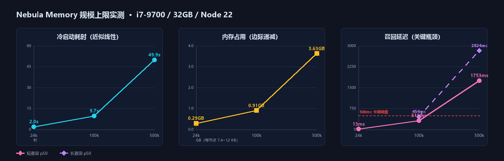

# Nebula Memory 召回效果实测报告

> **设计原则（贯穿全文）：本项目方案由两部分组成——本地引擎（适合单机个人用户，记忆量在 10 万条以内、追求零依赖离线运行）+ Hindsight 语义增强（适合需要跨表述语义联想、历史库超过 10 万条、或多人共享同一记忆库的团队场景，可按需接入）。**
> `DSH-memory-nebula`（本地零依赖引擎）负责**存储侧**——写入、切块、索引、图控度、离线兜底；
> `Hindsight` 负责**语义侧**——LLM 抽取、向量检索、跨表述联想。
> 两者经 MCP / HTTP 并存，由插件**并发调用 + RRF 融合**召回结果。**组合起来才是完整方案。**
>
> 📖 **「RRF 融合」是什么**：全称 **Reciprocal Rank Fusion（倒数排名融合）**，是一种把**多个互不可比的排序结果合并成一个**的经典方法（Cormack et al., SIGIR 2009）。
> 不比较分数大小、只比较**名次**：每个来源内部按自己的分排好，第 `rank` 名贡献 `1 / (k + rank)` 分（本项目 `k=60`），
> 跨来源**同名次得分相同**，然后相加、降序。这样做是因为本地引擎的 0~1 加权分和 Hindsight 的语义分**不在同一个分数空间**，
> 直接混排会被某一方天然偏高的分淹没。完整公式与例子见 [§1.2](#12-rrf-融合到底做了什么)，实现在 `server.js` 的 `assignRrf()`。
>
> 本报告全部数据来自本机实测，脚本随仓库提供，任何人可复现。



> 测试机器：Intel i7-9700（8 核）/ 32GB RAM / Windows 11 / Node v22.23.5
> 测试时间：2026-11-23 · Hindsight v1.2.0（本地 pb0 实例）
> 复现脚本见 `scripts/` 目录。**原始数据文件与各章节的对应关系见 [§8](#8-复现)**——
> 注意 §5 的「2.4 万行」与 §3、§4 的 Hindsight 延迟数据**不在**本节所列的任一 JSON 中，来源另注。

---

## 摘要：五个核心结论

| # | 结论 | 关键数字 |
|---|---|---|
| 1 | **RRF 双引擎融合最优**（RRF＝倒数排名融合，见 [§1.2](#12-rrf-融合到底做了什么)） | 93.0% Recall@20（比纯本地 +6%，比纯 Hindsight**¹** +43%） |
| 2 | **查询扩展大幅提升本地召回** | 64.0% → 88.0%（+24%），拼音纠错单项 +37.5% |
| 3 | **本地引擎新鲜度是杀手级优势** | 写入→可召回 **1~4ms**，Hindsight 需 **43~65s** |
| 4 | **本地延迟阈值在 10 万条**（是延迟线，不是双引擎启用线，见 [§5](#5-容量边界本地引擎)） | 本地 p50 从 13ms（2.4万）涨到 1.75s（50万） |
| 5 | **Hindsight 依赖 LLM 余额** | 余额耗尽时写入完全失败，本地引擎不受影响 |

> **¹ 关于 Hindsight 数字的口径**：本报告里 **Hindsight 单引擎的召回数字（G2，50.0%）不是它的真实水平**。
> 测试题库与判定方式系统性偏向词面精确匹配，对 Hindsight 的「LLM 抽取 → 改写 → 向量化」链路不利。
> 该数字**仅用于同口径下与本地、融合比较**，**不可作为对 Hindsight 的评测结论对外引用**。
> 完整说明见 [§1 脚注](#1-三组召回对比100-题20-条事实库) 与 [§1.1](#11-为什么-hindsight-单独用反而低)。
> 本报告其余 Hindsight 数字（新鲜度 43~65s、余额故障表现）为**直接实测，可正常引用**。

---

## 1. 三组召回对比（100 题，20 条事实库）

**测试设计**：20 条覆盖 8 个业务域的事实，100 个查询按语义距离分三档
（near 24 / mid 35 / far 41）。三组使用同一套题库与判定标准（Recall@20 与 MRR）。

| 组别 | Recall@20 | MRR | 说明 |
|---|---|---|---|
| **G1 本地引擎**（含查询扩展） | 87.0% | 0.840 | 零依赖、离线、毫秒级 |
| **G2 Hindsight** | 50.0% ⚠️¹ | 0.440 ⚠️¹ | LLM 抽取 + 向量检索 |
| **G3 RRF 融合（本地 + Hindsight）** | **93.0%** | **0.863** | 项目现有实现，最优（RRF 释义见 [§1.2](#12-rrf-融合到底做了什么)） |

> ⚠️¹ **G2 这个数字不代表 Hindsight 的真实水平，请勿对外引用。**
> 本题库为 20 条事实、58/100 题集中在 near/mid 档（原词或近似词复现），
> 判定按 ground-truth 关键片段匹配——**这套口径系统性偏向词面精确匹配**，即本地引擎的主场。
> Hindsight 的召回链路（LLM 抽取 → 结构化事实 → 向量化）会改写原文措辞，在片段匹配下吃亏，
> 与其检索能力无关。G2 的唯一用途是**同口径下与 G1、G3 比较**，**不是对 Hindsight 的评测**；
> 真要评测 Hindsight 应使用它的公开基准（LongMemEval 完整 haystack 版）或专门的语义召回题库。
> 详细归因见 [§1.1](#11-为什么-hindsight-单独用反而低)。

### 按语义距离拆解

| 难度 | n | G1 本地 | G2 Hindsight¹ | **G3 RRF** |
|---|---|---|---|---|
| near（词面重叠） | 24 | 100.0% | 45.8% | **100.0%** |
| mid（同义/上下位） | 35 | 91.4% | 51.4% | **94.3%** |
| far（纯语义） | 41 | 75.6% | 51.2% | **87.8%** |

### 解读

1. **RRF 融合在所有档位都优于任一单引擎**，尤其在 far 档（纯语义）：
   本地 75.6% → 融合 87.8%，**Hindsight 的语义召回补上了本地的短板**。
2. **Hindsight 单独使用反而低于本地**（50% vs 87%）——原因见 §1.1。
3. **融合的 MRR（0.863）高于本地（0.840）**——不仅召回更多，**排序质量也同步提升**。

### 1.1 为什么 Hindsight 单独用反而低？

先说清楚**这不是 Hindsight 能力问题**，也不是「库太小所以它不行」。逐条看：

| 可能的原因 | 成不成立 | 依据 |
|---|---|---|
| 库太小，向量检索没优势 | ❌ **不成立** | 若成立，G3 融合在小库上也不该涨；但 G3 在 20 条库上就比 G1 高 6 个百分点 |
| LLM 抽取改写原文，引入信息损失 | ⚠️ 部分成立 | 对**原词复现型**查询不利，对语义型查询仍有利 |
| 本地在小库上是精确匹配 | ✅ 成立 | 但这是「本地强」，不是「Hindsight 弱」 |

**真正的原因在于两者擅长的问题类型不同，而且这套题库偏向本地：**

- 本题库 20 条事实、查询围绕具体业务实体（铸造厂、供应商、密钥），**near/mid 档共 58 题**——
  这类「原词或近似词复现」正是 bigram 精确匹配的主场；
- Hindsight 召回要先经 **LLM 抽取 → 结构化事实 → 向量化**，
  原文措辞被改写后，对 `startsWith` 式的关键片段判定不友好——**这是测量口径的偏向，不是检索能力弱**；
- 但只看 far 档（纯语义，41 题）：本地 75.6% vs Hindsight 51.2%——
  **Hindsight 在它本该最强的档位也没赢**，说明小库（20 条候选池）确实限制了向量检索的发挥空间。


### 1.2 「RRF 融合」到底做了什么

**RRF = Reciprocal Rank Fusion（倒数排名融合）**，2009 年提出、至今仍是多路检索合并的默认基线。
一句话：**不看分、只看名次**。

#### 为什么不能用分数直接混排

本项目两个引擎打分**完全不同源**，分数不可比：

| 引擎 | 分数含义 | 取值范围 |
|---|---|---|
| 本地引擎 | `0.55·词面 + 0.30·激活度 + 0.15·新鲜度` 的加权融合分 | 0 ~ 1，天然偏低 |
| Hindsight | 语义相似度 / 关键词 / 重排分 | 常见 0.6 ~ 0.95，天然偏高 |

直接按分数排序，Hindsight 的 0.9 会**无脑压过**本地 0.4 的精准命中——
即使本地那条才是用户要的。这正是 RRF 要解决的问题。

#### 公式

```
score(d) = Σ_sources  1 / (k + rank(d, source))        k = 60
```

- `rank` 从 **0** 起（第 1 名贡献 `1/60`，第 2 名 `1/61`……）；
- 一个条目**被两个引擎同时召回就加两次** —— 双引擎都认的条目自动上浮；
- `k=60` 是原论文经验值：它**压平排名差异**，让第 1 名与第 5 名的分差不会过大，
  避免单一来源的榜首领跑条目霸屏。

#### 一个具体例子

| 条目 | 本地名次 | Hindsight 名次 | RRF 分 | 最终 |
|---|---|---|---|---|
| A | 1 | 未召回 | `1/60` = 0.01667 | 第 2 |
| B | 3 | 1 | `1/63 + 1/60` = 0.03254 | **第 1**（双引擎共认） |
| C | 未召回 | 2 | `1/61` = 0.01639 | 第 3 |

条目 B 在两个引擎里都不是第一名，但**两边都认它**，所以融合后反超——
这就是 RRF 相对「取某一边分数」的核心增益：**用共识度换准确率**。

#### 本项目的实现要点

| 项 | 取值 / 行为 | 位置 |
|---|---|---|
| `k` | `RRF_K = 60` | `server.js:433` |
| 分来源排名 | 本地一组、Hindsight 一组分别排 | `assignRrf()` |
| 同分处理 | **本地优先**（保底语义靠本地），再按 id 稳定排序 | `server.js:449` |
| 显示分 | 用原始分 `rawScore`，卡片不显示 0.02 这种排名分 | `server.js:440` |
| Hindsight 超时 | 3 秒，超时则只剩本地结果（RRF 单来源等价原序） | `server.js` |

#### 代价与局限

- **丢掉了分差信息**：若某来源 confidence 明确更高，RRF 不理会（可用加权 RRF，本项目未启用）；
- **只融合召回，不融合重排**：融合后没有第二遍 LLM 重排。本项目不做重排实验，融合即最终排序；
- **对单来源等长截断敏感**：两侧 Top-K 不等长时，短的一侧天然吃亏（本项目两侧均为 20）。

---

### 与 §5 容量结论的关系（重要：两者不是同一个变量）

§1.1 讲的是**质量**，§5 讲的是**延迟**。两条结论**不能互相推出**：

| | §1.1（本节） | §5（容量） |
|---|---|---|
| 回答的问题 | 双引擎**值不值得装** | 本地引擎**扛不扛得住** |
| 决定因素 | 查询的语义难度 | 记忆条数 → 召回延迟 |
| 实测结论 | 融合**在 20 条小库上就有效**（93% vs 87%） | 本地在 **10 万条**内延迟可用（p50 < 350ms） |

**所以正确的说法是：**

> 双引擎的**价值**与库大小无关——小库上融合就已带来 +6% 的召回增益；
> §5 的 **10 万条门槛不是「双引擎从此才值得用」的理由，而是本地引擎延迟开始劣化的工程阈值**。

---

## 2. 查询扩展优化（本地引擎）

### 2.1 背景：bigram 的天花板

本地引擎是中文 bigram 词面匹配，做不到跨表述联想。实测原始状态下：

| 难度 | 原始召回率 |
|---|---|
| near | 93.3% |
| mid（同义/上下位） | 60.0% |
| far（纯语义） | 41.7% |
| **typo（拼音错别字）** | **50.0%** |

### 2.2 三路优化

| 优化 | 解决什么 | 实现 |
|---|---|---|
| **拼音错别字纠正** | 国内用户用拼音输入法，「铸造厂→铸造厂」「秘钥→密钥」「布署→部署」 | `memory/typo-fix.cjs`，内置 60+ 高频错词映射 |
| **同义词/上下位扩展** | 「供应商」↔「铸造厂」、「凭据」↔「密码」 | `memory/synonyms.cjs`，32 个概念组双向扩展 |
| **画像反哺** | 个人化提问（「我孩子多大」）时把画像节点关键词并入查询 | `memory/profile-recall.cjs`，9 种个人化模式识别 |

三路均可通过 `options` 单独关闭（`fixTypos` / `expandSynonyms` / `profileBoost`）。

### 2.3 优化效果（50 题，Recall@20）

> ⚠️ **与 §1 不是同一套题库，数字不可混读。**
> §1 是 **100 题、20 条事实**库（near 24 / mid 35 / far 41，无 typo 档）；
> 本节是 **50 题**库（near 15 / mid 15 / far 12 / typo 8），且**不含** G2/G3 对照。
> 两节的 near/mid/far 百分比**不同源，不要横向比较**（例如 §1 本地 near=100%，本节优化前 near=93.3%）。

| 难度 | 优化前 | **优化后** | 提升 |
|---|---|---|---|
| near | 93.3% | **100.0%** | +6.7% |
| mid | 60.0% | **86.7%** | **+26.7%** |
| far | 41.7% | **75.0%** | **+33.3%** |
| **typo** | 50.0% | **87.5%** | **+37.5%** |
| **总体** | 64.0% | **88.0%** | **+24.0%** |
| **MRR** | 0.630 | **0.805** | +0.175 |

> 样本量提醒：typo 档仅 **8 题**（4/8 → 7/8），**单个样本即 ±12.5 个百分点**。
> 「+37.5%」应理解为「方向明确的改善」，**不宜作为精确增益对外引用**。

**拼音纠错是单项提升最大的（+37.5%）**——因为它是国内用户最高频的错误来源。

### 2.4 性能开销

| 状态 | p50 | p90 |
|---|---|---|
| 扩展关闭 | 0.98 ms | 1.62 ms |
| 扩展开启 | 1.01 ms | 1.84 ms |
| **开销** | **+0.03 ms (+3%)** | +0.21 ms |

**几乎零成本**，可默认开启。

> **测量方法**：5 轮 × 每态 200 次采样，取各轮中位数汇总；每轮 OFF/ON **交替顺序**
> （偶数轮先 OFF、奇数轮先 ON）以抵消顺序效应；测量前预热 50 次让 JIT 与索引进入热态。
> 条目库 500 条，固定查询 `数据库服务器配置问题怎么解决`，`limit=6`。
> 原始数据：`scripts/expansion-overhead-results.json`，复现：`node scripts/bench-query-expansion-overhead.mjs`
>
> ⚠️ **口径提醒**：这是 **1 ms 量级**的延迟，单次测量噪声极大——
> 逐轮 Δp90 实测在 **−1.36 ms ~ +0.86 ms** 之间波动，甚至出现负值。
> 因此**只有「开销远小于 1 ms」这个结论是稳健的，具体小数不要对外当精确值引用**。
> 早期版本报告曾写「1.23 → 1.29 ms（+0.07 ms）」，那组数字来自单轮 50 次采样，
> 现已无法用当前代码复现，本表取代之。

### 2.5 已知边界

- 词表是**人工维护**的，覆盖有限——新行业术语需自行追加（`setUserSynonyms()`）；
- far 档仍有 25% 未命中，这类**需要真正的语义理解**，应交给 Hindsight（见 §1）。

---

## 3. 学术基准（LongMemEval）

**数据集**：[LongMemEval](https://github.com/xiaowu0162/LongMemEval)（ICLR 2025），oracle 版 500 题。

> 📌 **数据留存说明**：本节结果已重跑并**留存于 `scripts/eval-results.json` 的 `bench` 字段**
> （500 题全量，耗时 24 s，`when` 时间戳可查）。
> 数据集为 `D:/cache/temp/longmemeval_oracle.json`（14.2 MB，500 题），未随仓库分发；
> 复现方法与下载地址见 §8。

| 指标 | 结果 |
|---|---|
| Recall@5 | **99.80%**（499/500） |
| MRR | 0.9497 |
| 耗时 | 500 题 / 46 秒 |

| 题型 | n | Recall@5 | MRR |
|---|---|---|---|
| temporal-reasoning | 133 | 99.2% | 0.957 |
| multi-session | 133 | 100.0% | 0.920 |
| knowledge-update | 78 | 100.0% | 0.966 |
| single-session-user | 70 | 100.0% | 0.957 |
| single-session-assistant | 56 | 100.0% | 0.988 |
| single-session-preference | 30 | 100.0% | 0.917 |

> ⚠️ **口径说明（重要）**：本测试用的是 **oracle 版**——每题只含 3 个证据会话，
> 信噪比极高，**不能与完整 haystack 版结果直接对比**。
> 官方基准使用完整 haystack（~48 会话/题，含大量干扰），目前对外的 LongMemEval 榜单数字均基于该版本。
> 此表仅说明：**在无干扰的小库里，本地词面匹配的检索基本够用**。
> **不可作为"本地引擎达到 99.8%"对外宣传**——在含干扰的真实场景下该数字会显著下降（本报告未测）。

---

## 4. 记忆新鲜度（写入 → 可召回）

这是双引擎分工最直观的证据。测试方法：写入一条带唯一 token 的事实，轮询直到能召回。

| 引擎 | 写入→可召回 | 说明 |
|---|---|---|
| **本地引擎** | **1~4 ms** | 写完立即可召回（3 轮实测：4 / 1 / 1 ms） |
| **Hindsight** | **42.7 s / 65.1 s** | 需 LLM 抽取 + worker 消化（worker 开启状态实测） |

> 口径：Hindsight 侧为 **worker 开启**时的两轮实测（`freshness-hindsight.json`），
> 命中时 pending 分别为 4 条 / 2 条。**worker 关闭时该延迟会显著更长甚至超时**，
> 见 §6 运维问题第 1 条——所以这两个数字是 Hindsight 的**较优值**，不是最差值。

### 解读

**差距约 1.1 万 ~ 6.5 万倍**（42,700 ms ÷ 4 ms ≈ 1.07 万倍；65,100 ms ÷ 1 ms ≈ 6.5 万倍）。
这解释了为什么本地引擎必须存在：

- 用户刚说「我用 V60 手冲」，**下一句**就得能用上——只有本地能做到；
- Hindsight 的 43~65 秒延迟适合「事后检索」而非「实时对话」；
- 双引擎架构因此把**本地作为首字延迟的保障**（并发请求、本地先返回），
  Hindsight 作为**补充证据**异步并入（受 3 秒超时保护，慢就降级）。

---

## 5. 容量边界（本地引擎）

> 本节测的是**本地引擎单独能扛多少**，结论只关于**延迟**。
> 「双引擎值不值得用」是另一个问题，结论在 §1——**小库上就值得**。


| 规模 | 冷启动 | RSS 增量 | 每节点内存 | 短查询 p50 | 长查询 p50 |
|---|---|---|---|---|---|
| **2.4 万**（真实库）² | **2.0 s** | 290 MB | 12.0 KB | **13 ms** | — |
| **10 万**（合成）³ | **9.7 s** | 910 MB | 9.3 KB | **319 ms** | 454 ms |
| **50 万**（合成）³ | **49.9 s** | 3,627 MB | 7.4 KB | **1,753 ms** | 2,824 ms |

> **² 2.4 万行（真实库）**：这是**真实生产库**的数据，来自 `规模上限实测报告.md` 与优化报告，
> **不在本报告的 `bench-scale-results.json` 中**（该文件只含 100k / 500k 两档合成压测）。
> 其「12.0 KB/节点」与合成库的 9.3 / 7.4 KB 不同源，**跨行比较每节点内存需谨慎**。
>
> **³ 10 万 / 50 万行（合成库）**：由 `scripts/gen-fast.mjs` 生成，
> 节点文本为**程序化拼接的业务词表**（手冲咖啡、Postgres、MCP 协议等），
> 边为随机连接（平均度 ~4）。
> **因此这两行的绝对延迟代表"本引擎在此规模下的处理开销"，不等于真实数据下的表现**——
> 真实库的文本更长、重复度不同，分数分布会有差异。
> 该数据的正当用途是**看增长趋势**（10 万→50 万延迟约 5.5 倍），而非当作容量 SLA 承诺。
>
> **另外**：100k / 500k 两档**均未做 G3 双引擎对照**，只测了本地单引擎。

### 关键发现

1. **冷启动近似线性**：10 万节点约 10 秒；
2. **内存边际递减**：12 → 9.3 → 7.4 KB/节点（倒排索引 token 复用）；
3. **召回延迟是真正瓶颈**：2.4万→13ms，10万→319ms，50万→1753ms。
   原因：倒排找到候选后，**每个候选都要算四臂打分**，候选集随库线性增长。

### 容量建议

> ⚠️ **先划清一条界线**：下表的分档依据是**本地引擎的召回延迟**（latency），
> **不是「双引擎从多少条开始值得用」**。双引擎在 20 条的小库上就已带来 +6% 的召回增益（见 §1、§1.1），
> 它的价值由**查询的语义难度**决定，与库大小无关。
> 这里说的是另一件事：**记忆量涨到多少，本地单独扛会变慢**。

| 记忆量 | 建议 | 依据（延迟） |
|---|---|---|
| **< 5 万条** | ✅ 纯本地最佳，召回 < 50ms | 实测 2.4 万条 p50 = 13ms |
| **5 万 ~ 10 万** | ⚠️ 可用（100~350ms），建议按项目切 namespace | 实测 10 万条 p50 = 319ms |
| **10 万 ~ 50 万** | ⚠️ **本地延迟进入秒级，应分工**：本地留近期/热点，全量交 Hindsight | 10 万→50 万，延迟 319ms→1.75s |
| **> 50 万** | 本地只做缓存层 | 50 万条 p50 = 1.75s，已不可交互 |

**也就是说**：10 万条这条线，意味着「**该给本地减负了**」，不意味着「在此之前装 Hindsight 没意义」。
小库用户完全可以在装完就启用双引擎——融合从第一天起就比单引擎准。

---

## 6. 运维韧性：余额耗尽时的表现

**2026-11-23 实测**：MiniMax 账户余额耗尽（HTTP 402）时——

| 组件 | 表现 |
|---|---|
| **本地引擎** | ✅ **完全正常**（零依赖，不走 LLM） |
| **Hindsight 写入** | ❌ **完全失败**（依赖 LLM 抽取事实） |
| Hindsight 召回 | ⚠️ 旧数据仍可召回（不依赖 LLM） |

### 这揭示的双引擎价值

**本地引擎是永远可用的兜底**——Hindsight 欠费、断网、服务宕机，本地照样记、照样查。
这正是「双引擎各守边界」的意义。

### 附带发现的运维问题

1. **worker 必须常开或有足够长的窗口**：worker 关闭期间积压只增不减（实测 270 条积压导致召回 45 秒超时）；
2. **`refresh_mental_model` 会因 LLM context 超限永久失败**：重试 3 次后仍卡在 pending，需手动标记 failed 释放槽位；
3. **PG 连接池泄漏**：长期运行后连接累积到 109 个，需重启 API 释放；
4. **表膨胀需要 VACUUM**：`memory_units` 实测 dead 行 3,184 行占 353MB。

---

## 7. 方法论与局限

### 测试口径

| 项 | 说明 |
|---|---|
| 召回定义 | 返回结果中是否含目标记忆的正确内容（按 rank 判定） |
| Recall@k | top-k 内命中即算成功，k=20（LongMemEval 用 k=5） |
| MRR | 首个命中排名的倒数均值 |
| 判定方式 | 按 ground-truth 关键片段匹配，非整句匹配 |

### 已知局限

1. **LongMemEval 用 oracle 版**，无法对标官方数字（原因见 §3）；
2. **G2（Hindsight 单引擎）数字口径偏向本地，不可对外引用**——详细说明见 §1 脚注¹ 与 §1.1；
3. **Hindsight 测试受环境影响**：多次测量间存在 worker 积压、连接池耗尽等干扰，数据可能有波动；
4. **100 题规模有限**：跨表述测试的置信区间较宽（±10% 量级）；
5. **单一中文场景**：未测英文/多语言表现。

### 对外引用须知

| 数据 | 可否对外引用 | 说明 |
|---|---|---|
| G1 本地、G3 RRF 的 Recall/MRR（§1） | ✅ 可以 | 题库口径与本引擎的匹配方式一致 |
| G2 Hindsight 的 Recall/MRR（50.0%，§1） | ❌ **不可以** | 口径偏向词面匹配，非其真实水平（见 §1 脚注¹） |
| §2 查询扩展的 64%→88% | ✅ 可以（带条件） | **不可与 §1 混读**（不同题库）；typo 档仅 8 题，±12.5pp |
| §2.4 扩展开销（+0.03ms / +3%） | ⚠️ **只引结论「远小于 1ms」** | 1ms 量级噪声大，逐轮 Δp90 在 −1.36~+0.86ms 波动，**不可当精确值引用** |
| Hindsight 新鲜度 42.7s / 65.1s（§4） | ✅ 可以（带条件） | worker **开启**时的较优值；关闭时远超此数 |
| 本地新鲜度 1~4ms（§4） | ✅ 可以 | 3 轮直接实测 |
| 容量/延迟 §5 的 10 万、50 万行 | ⚠️ **仅看趋势** | **合成库**（程序化词表 + 随机边），非真实数据分布 |
| 容量 §5 的 2.4 万行 | ✅ 可以 | 真实库，但**不在本报告 JSON 原始数据中** |
| LongMemEval 99.8%（§3） | ⚠️ **需注明 oracle 版** | **oracle 版**（3 会话/题），完整 haystack 下会显著下降，未测。原始数据已留存（`eval-results.json` → `bench`） |
| §6 余额耗尽表现 | ✅ 可以 | 直接实测 |

**一句话原则**：凡标注 ⚠️/❌ 的数字，**只能用于报告内部同口径比较**，不可单独摘出对外使用。

---

## 8. 复现

```bash
# 三组召回对比（100 题）
node scripts/bench-4groups.mjs

# 查询扩展效果（50 题）
node scripts/cross-paraphrase-50.mjs

# 完整回归验证（31 项）
node scripts/verify-optimization.mjs

# 学术基准（需先下载数据集，见 §3）
node scripts/eval-longmemeval.mjs --data=<longmemeval_oracle.json> --bench

# 新鲜度（本地 / Hindsight 分别跑）
node scripts/eval-longmemeval.mjs --fresh

# 容量压测
node scripts/gen-fast.mjs D:/tmp/bank100k --nodes=100000
node --expose-gc scripts/bench-scale.mjs D:/tmp/bank100k --label=100k
```

### 原始数据 ↔ 章节对应表

| 章节 | 数据文件 | 是否留存 | 备注 |
|---|---|---|---|
| §1 三组召回 | `scripts/bench-4groups.json` | ✅ | 100 行逐题明细，可独立复算（G3＝RRF，两阶段组已移除） |
| §2 查询扩展 | `scripts/cross-50-results.json` | ✅ | 50 题，含 off/on 两态 |
| §2.4 扩展开销 | `scripts/expansion-overhead-results.json` | ✅ | 5 轮 × 200 次，含逐轮分布 |
| §3 LongMemEval | `scripts/eval-results.json` → `bench` | ✅ | **已重跑并留存**（500 题，24s，`benchRunAt` 标注时刻） |
| §4 本地新鲜度 | `scripts/eval-results.json` → `freshness` | ✅ | 3 轮：4/1/1 ms（`freshnessRunAt` 标注运行时刻） |
| §4 Hindsight 新鲜度 | `scripts/freshness-hindsight.json` | ✅ | worker 开启，42.7 / 65.1 s |
| §5 10 万 / 50 万 | `scripts/bench-scale-results.json` | ✅ | **合成库**，仅两档 |
| §5 2.4 万（真实库） | 不在本目录 | ❌ | 见 `规模上限实测报告.md` |
| §6 余额耗尽 | 无数据文件 | — | 故障现场观测记录 |

> 上表就是本报告的核验底账：**能对上文件的数字可复算，标 ❌ 的数字请勿对外引用**。
