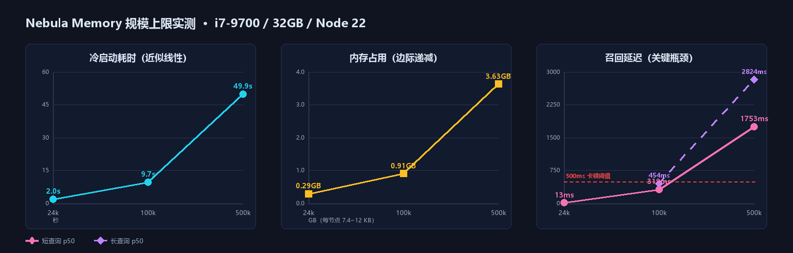

# Nebula Memory 规模上限实测报告

> **结论先行：纯本地引擎在 10 万条记忆以内可用（召回 p50 < 350ms）；超过 10 万条后召回延迟进入秒级，不再适合交互式场景。超过这个规模，建议装 Hindsight 做语义检索层，或按项目切 namespace 分库。**



> 测试机器：Intel i7-9700（8 核）/ 32GB RAM / Windows 11 / Node v22.23.5
> 测试时间：2026-11-23 · 代码版本：commit `a401979`（含自动压缩）
> 复现：`node scripts/gen-fast.mjs <目录> --nodes=N` 造库 → `node scripts/bench-scale.mjs <目录> --label=N`

---

## 1. 实测数据总表

| 规模 | nodes.jsonl | 冷启动 | RSS 增量 | 每节点内存 | 短查询 p50 | 中查询 p50 | 长查询 p50 |
|---|---|---|---|---|---|---|---|
| **2.4 万**（真实生产库） | 14.4 MB | **2.0 s** | 290 MB | 12.0 KB | **13 ms** | — | — |
| **10 万** | 58.2 MB | **9.7 s** | 910 MB | 9.3 KB | **319 ms** | 366 ms | 454 ms |
| **50 万** | 290 MB | **49.9 s** | 3,627 MB | 7.4 KB | **1,753 ms** | 2,239 ms | 2,824 ms |

> 「未命中」查询（完全不存在的词）在所有规模下都是 **0.01 ms** —— 倒排索引的直接查找是 O(1)，慢的是**候选集打分**。

## 2. 三个维度的拐点分析

### 2.1 冷启动：近似线性，每 10 万节点约 10 秒

```
2.4万 → 2.0s    10万 → 9.7s    50万 → 49.9s
```

线性增长，可预测。50 万节点 50 秒对「服务启动」类场景可接受，但如果每次启动都这么久就影响体验——
**建议保持自动压缩开启**（本仓 v1.2.0+ 已内置），把追加历史压回存活集，否则冷启动会因历史膨胀进一步恶化。

### 2.2 内存：边际递减（好消息）

```
12.0 KB/节点 → 9.3 KB/节点 → 7.4 KB/节点
```

节点越多，单位内存越小——倒排索引的 token 被大量复用。50 万节点占 3.6GB，32GB 机器完全够用。
**内存不是瓶颈。**

### 2.3 召回延迟：真正的瓶颈

```
2.4万 →  13 ms
10万  → 319 ms    (节点 ×4.2，延迟 ×24)
50万  → 1753 ms   (节点 ×5，  延迟 ×5.5)
```

**增长介于线性与超线性之间**。原因在于检索架构：

1. 倒排索引按 token 找到候选集（这一步很快）；
2. 但对**每个候选**都要算 TF-IDF 余弦 + 时间衰减 + 重要性 + 图邻居加成（四臂打分）；
3. 候选集随库规模线性增长 → 打分总耗时线性甚至超线性增长。

10 万节点时 p50 = 319ms 已经跨过「用户可感知」的边缘；50 万节点 1.7~2.8 秒，
**交互式场景不可接受**。

## 3. 容量边界建议

| 记忆量 | 适用性 | 建议 |
|---|---|---|
| **< 5 万条** | ✅ 最佳区间 | 纯本地，召回 < 50ms，无感知 |
| **5 万 ~ 10 万** | ⚠️ 可用 | 召回 100~350ms，仍可接受；建议开启 namespace 按项目分库 |
| **10 万 ~ 50 万** | ❌ 不推荐纯本地 | 召回进入秒级。**装 Hindsight 做语义检索层**，本地只保留近期/热点记忆 |
| **> 50 万** | ❌ 超出设计范围 | 必须上 Hindsight 或外部向量库 |

### 推荐做法：双结构分工

这正是本项目设计的初衷——**本地轻量 + 外部增强**：

- **本地（NebulaMemory）**：保留最近 3~6 个月的活跃记忆（通常 1~3 万条），保证毫秒级召回；
- **Hindsight**：全量历史 + 语义检索，处理跨表述联想（见 [FAQ](性能实测报告.md) 中 bigram 天花板的说明）；
- 两者通过 MCP/HTTP 并存，插件自动融合两路结果。

## 4. 已知的优化空间（未实施）

若要提升纯本地的规模上限，有这些方向：

| 方向 | 预期收益 | 代价 |
|---|---|---|
| 倒排候选集 top-K 预截断 | 召回延迟线性下降 | 可能漏掉低分但相关的记忆 |
| 增量索引（只打分增量部分） | 写入更快 | 架构复杂 |
| 向量化预筛（轻量 embedding） | 候选集缩小 10~100× | 破坏「零依赖」定位 |
| 按 namespace 分片并行打分 | 利用多核 | 需调整检索入口 |

**当前不做**：这些都会牺牲「零依赖 / 简单可读」的核心取舍。规模需求用 Hindsight 解决更合适。

## 5. 原始数据

完整的分查询明细见 [`../scripts/bench-scale-results.json`](../scripts/bench-scale-results.json)。

## 6. 复现步骤

```bash
# 1) 生成合成库（10 万条，约 1 秒）
node scripts/gen-fast.mjs D:/tmp/bank100k --nodes=100000

# 2) 跑规模基准
node --expose-gc scripts/bench-scale.mjs D:/tmp/bank100k --label=100k

# 结果追加到 scripts/bench-scale-results.json
```

合成数据特点（贴近真实）：平均文本 166 字，10% 为 800~2000 字长文本，
含中英混合与技术术语，时间分布在过去 180 天。
